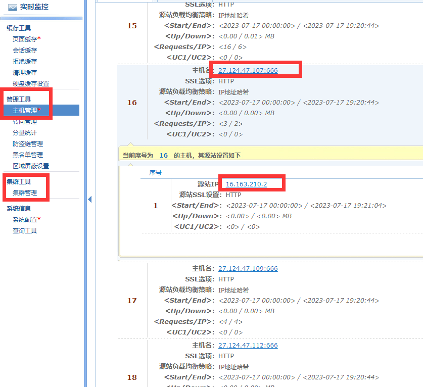
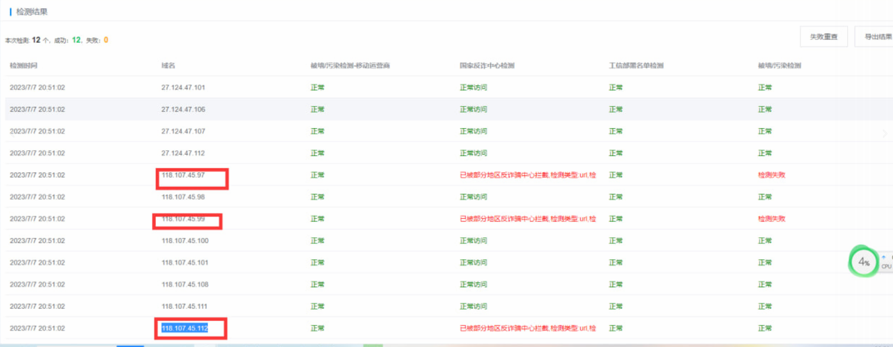

# 某业务平台全面优化 https：//目标示例

> 原文：[某业务平台全面优化 https：//目标示例](https://ji-shu-jian-li.gitbook.io/ben_bird/ag-zun-long-kai-shi-quan-mian-you-hua-httpsz6.com.md)

> 归档性质：比赛结束后的授权安全演练复盘；正文中的凭据和联系信息已脱敏，图片保留比赛复盘原帖。

**某业务平台全面优化** [**示例地址)

**自建cdn + 批量干净ip节点 + 自研int技术 + 签名加密技术**

**自建cdn**

**批量干净ip节点**

