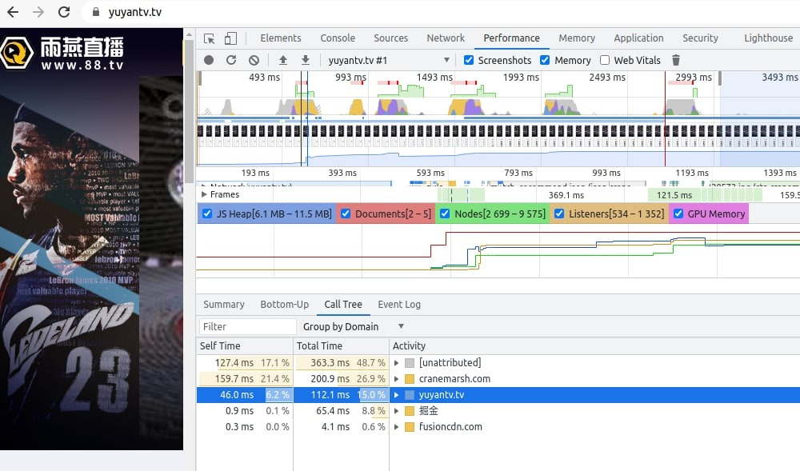
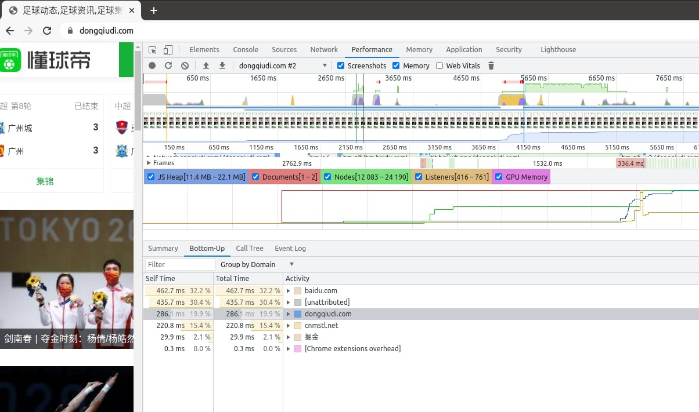
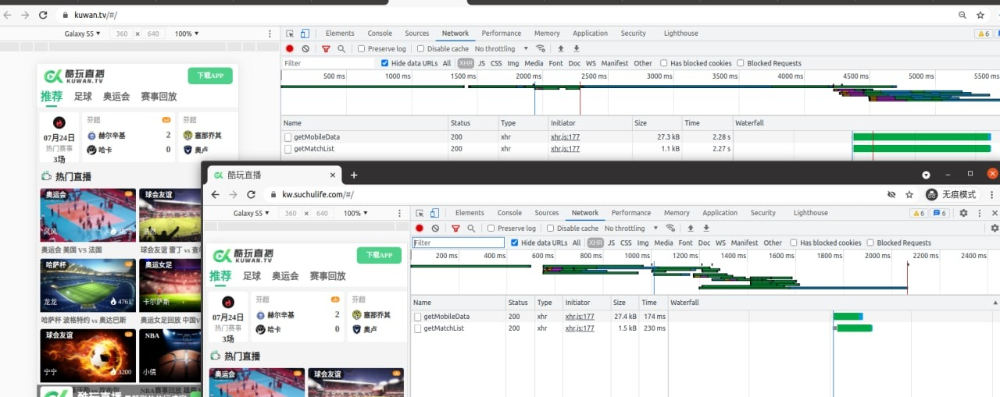

# 直播方案 - 域名同时跑多家cdn节点，并调度最好的节点服务

> 原文：[直播方案 - 域名同时跑多家cdn节点，并调度最好的节点服务](https://ji-shu-jian-li.gitbook.io/ben_bird/zhi-bo-fang-an-yu-ming-tong-shi-pao-duo-jia-cdn-jie-dian-bing-diao-du-zui-hao-de-jie-dian-fu-wu.md)

> 归档性质：比赛结束后的授权安全演练复盘；敏感目标、凭据和截图已脱敏。

**直播方案 - 域名同时跑多家cdn节点，并调度最好的节点服务**

涉及到vue的懒加载，首页静态化，本地化全部外部js css 样式库，打包体积压缩，和SEO异常验证方面，安卓报毒解决，苹果签名渠道，广告投放等
