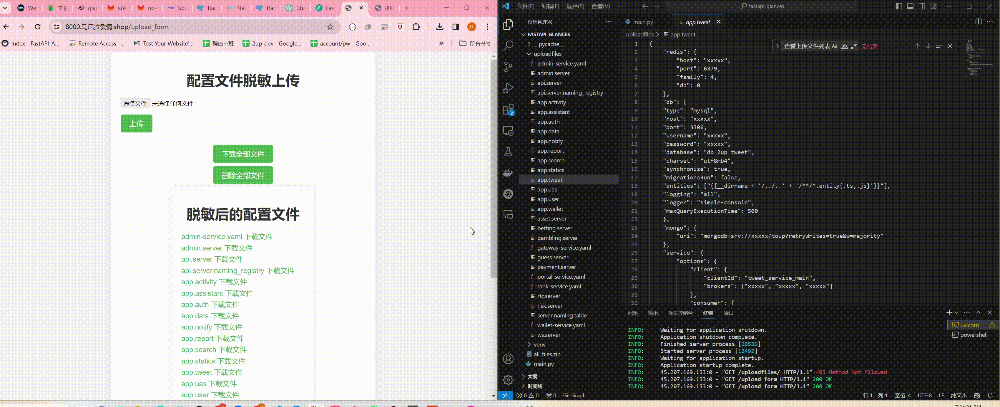

# 线上配置文件脱敏工具编写

> 原文：[线上配置文件脱敏工具编写](https://ji-shu-jian-li.gitbook.io/ben_bird/xian-shang-pei-zhi-wen-jian-tuo-min-gong-ju-bian-xie.md)

> 归档性质：比赛结束后的授权安全演练复盘；敏感目标、凭据和截图已脱敏。



[原始媒体链接已归档]

````python
```python
from fastapi import FastAPI, File, UploadFile, Response
from fastapi.responses import HTMLResponse, FileResponse
import os
import zipfile

app = FastAPI()

# 指定上传文件的目标文件夹
UPLOAD_FOLDER = "uploadfiles"

# 如果目标文件夹不存在，则创建它
if not os.path.exists(UPLOAD_FOLDER):
    os.makedirs(UPLOAD_FOLDER)

def get_files_list():
    """获取上传的文件列表"""
    files = os.listdir(UPLOAD_FOLDER)
    file_list = "\n".join(
        f'<li><a href="/download/{file}">{file}</a> <a href="/download/{file}">下载文件</a></li>' for file in files
    )
    return file_list

@app.post("/uploadfiles/")
async def upload_files(files: list[UploadFile] = File(...)):
    """
    上传文件功能
    :param files: 上传的文件列表
    :return: 返回上传结果
    """
    # 定义敏感字符串列表，用于替换敏感信息
    sensitive_strings = [
        "test-master-slave.vnt2qy.ng.0001.apse1.cache.amazonaws.com",
        "es-log.es.ap-southeast-1.aws.found.io",
        "ema21ioirJikXIkLCJugmeiv",
        "database-test1.cvjrqhcoolrr.ap-southeast-1.rds.amazonaws.com",
        "devadmin:[邮箱已脱敏]",
        "kafka-0.kafka-headless:9092",
        "kafka-1.kafka-headless:9092",
        "kafka-2.kafka-headless:9092",
        "BKun3DY5aFvU",
        "devadmin",
        "Ix7J48iq4H6sjaSTSHFz5AjQ",
        "com.mysql.cj.jdbc.Driver"
    ]

    try:
        for file in files:
            # 将每个文件保存到服务器的指定目录
            file_path = os.path.join(UPLOAD_FOLDER, file.filename)
            with open(file_path, "wb") as buffer:
                # 替换敏感字符串并写入文件
                content = file.file.read().decode("utf-8")
                for sensitive_string in sensitive_strings:
                    content = content.replace(sensitive_string, "xxxxx")
                buffer.write(content.encode("utf-8"))
        # 文件上传成功后重定向到文件列表页面
        return Response(content="""<!DOCTYPE html><html><head><meta charset="UTF-8"><meta http-equiv="refresh" content="3;URL='/files/'"><title>配置文件脱敏上传</title><style>body {font-family: Arial, sans-serif;}</style></head><body><h1>配置文件脱敏上传成功. 正在去除敏感信息...</h1></body></html>""", status_code=303)
    except Exception as e:
        return {"error": f"上传文件出错: {str(e)}"}

@app.get("/upload_form", response_class=HTMLResponse)
async def upload_form():
    """
    显示上传文件的表单页面
    """
    file_list = get_files_list()
    upload_form_content = f"""
    <!DOCTYPE html>
    <html>
    <head>
        <meta charset="UTF-8">
        <title>配置文件脱敏上传</title>
        <style>
            body {{
                font-family: Arial, sans-serif;
                margin: 0;
                padding: 0;
                background-color: #f4f4f4;
            }}
            .container {{
                width: 50%;
                margin: auto;
                background: #fff;
                padding: 20px;
                border-radius: 5px;
                box-shadow: 0 0 10px rgba(0, 0, 0, 0.1);
            }}
            h1 {{
                color: #333;
                text-align: center;
                margin-bottom: 20px;
            }}
            input[type="file"] {{
                margin-bottom: 10px;
            }}
            input[type="submit"], input[type="button"] {{
                background-color: #4CAF50;
                border: none;
                color: white;
                padding: 10px 20px;
                text-align: center;
                text-decoration: none;
                display: inline-block;
                font-size: 16px;
                margin: 4px 2px;
                cursor: pointer;
                border-radius: 5px;
            }}
            a {{
                color: #4CAF50;
                text-decoration: none;
            }}
            .button-container {{
                text-align: center;
                margin-top: 20px;
            }}
            ul {{
                list-style: none;
                padding: 0;
            }}
            li {{
                margin-bottom: 5px;
            }}
        </style>
    </head>
    <body>
        <div class="container">
            <h1>配置文件脱敏上传</h1>
            <form action="/uploadfiles/" method="post" enctype="multipart/form-data">
                <input type="file" name="files" multiple>
                <br>
                <input type="submit" value="上传">
            </form>
            <div class="button-container">
                <form action="/download_all_files/" method="post">
                    <input type="submit" value="下载全部文件">
                </form>
                <form action="/delete_all_files/" method="post">
                    <input type="submit" value="删除全部文件">
                </form>
            </div>
            <div class='container'><h1>脱敏后的配置文件</h1><ul>{file_list}</ul>
        </div>
    </body>
    </html>
    """
    return HTMLResponse(content=upload_form_content)

@app.get("/files/", response_class=HTMLResponse)
async def list_files():
    """
    显示上传的文件列表
    """
    file_list = get_files_list()
    return HTMLResponse(content=f"""
    <!DOCTYPE html>
    <html>
    <head>
        <meta http-equiv='refresh' content='0;URL=/upload_form/'>
    </head>
    <body>
    </body>
    </html>
    """)

@app.get("/download/{file_name}/")
async def download_file(file_name: str, response: Response):
    """
    提供下载文件的功能
    """
    file_path = os.path.join(UPLOAD_FOLDER, file_name)
    if os.path.exists(file_path):
        return FileResponse(file_path, media_type='application/octet-stream', filename=file_name)
    else:
        response.status_code = 404
        return {"error": f"文件 {file_name} 不存在"}

@app.post("/download_all_files/")
async def download_all_files(response: Response):
    """
    提供下载全部文件的功能
    """
    zip_file_path = "all_files.zip"
    with zipfile.ZipFile(zip_file_path, "w") as zip_file:
        for file_name in os.listdir(UPLOAD_FOLDER):
            file_path = os.path.join(UPLOAD_FOLDER, file_name)
            if os.path.isfile(file_path):
                zip_file.write(file_path, arcname=file_name)
    if os.path.exists(zip_file_path):
        return FileResponse(zip_file_path, media_type='application/zip', filename="all_files_已脱敏.zip")
    else:
        response.status_code = 404
        return {"error": "没有文件可下载"}

@app.post("/delete_all_files/")
async def delete_all_files():
    """
    删除所有文件
    """
    for file_name in os.listdir(UPLOAD_FOLDER):
        file_path = os.path.join(UPLOAD_FOLDER, file_name)
        if os.path.isfile(file_path):
            os.remove(file_path)
    # 删除完成后重定向到上传文件表单页面
    return HTMLResponse(content="""<meta http-equiv='refresh' content='0;URL=/upload_form/'>""")

if __name__ == "__main__":
    import uvicorn

    uvicorn.run(app, host="203.0.113.1", port=8000, reload=True)

```
````
