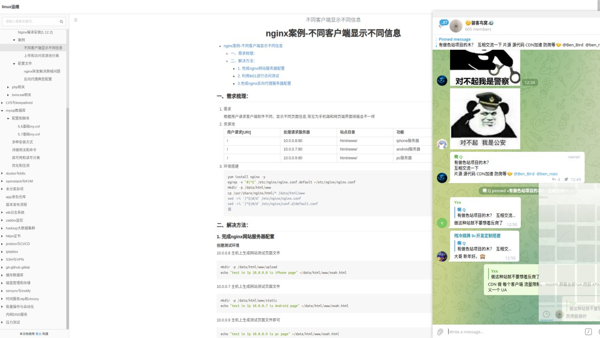
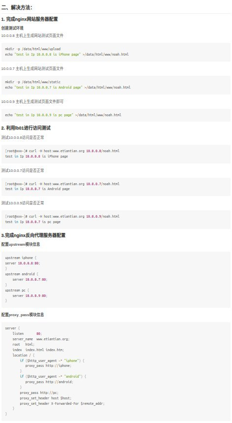
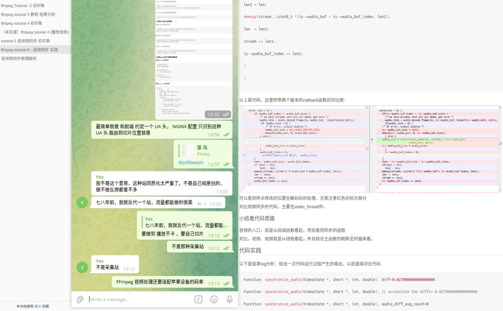
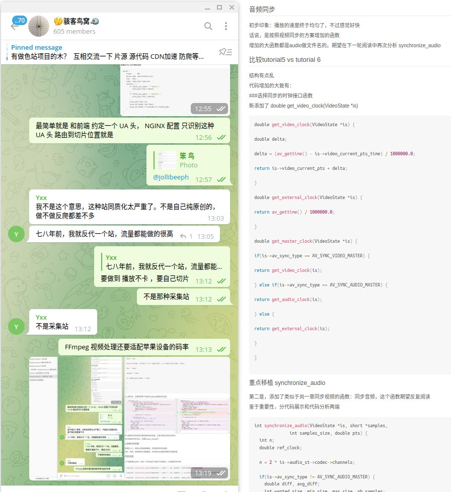

# 色站防爬虫

> 原文：[色站防爬虫](https://ji-shu-jian-li.gitbook.io/ben_bird/se-zhan-fang-pa-chong.md)

> 归档性质：比赛结束后的授权安全演练复盘；正文中的凭据和联系信息已脱敏，图片保留比赛复盘原帖。

CDN 做 每个客户端 流量限制， NGINX 访问策略验证全部 UA 然后 APK 内自定义一个 UA

FFmpeg 视频处理还要适配苹果设备的码率

