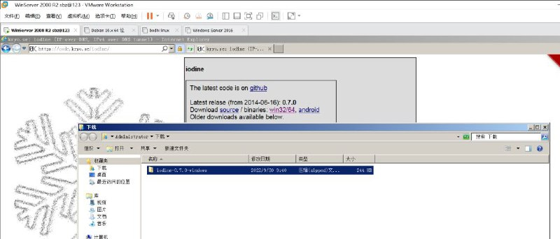
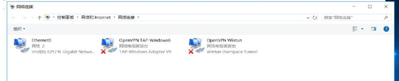
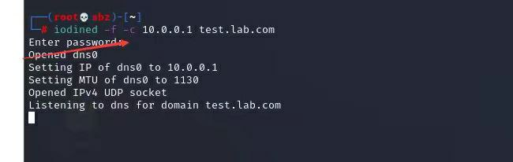
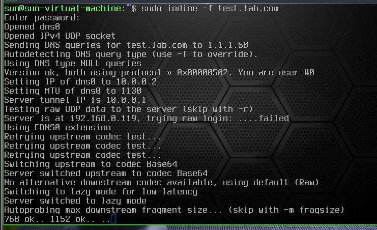
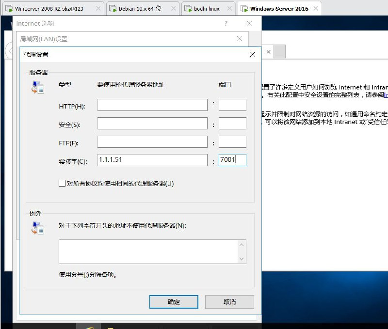
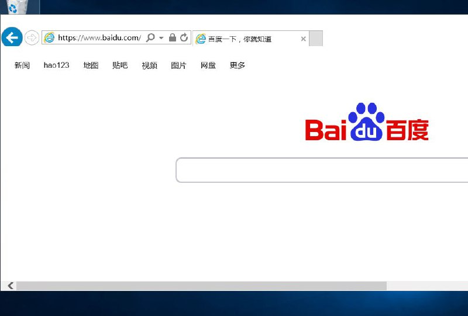

# DNS协议隧道之iodine内网穿透实现内网window正常上网（某业务平台市场运营需求）

> 原文：[DNS协议隧道之iodine内网穿透实现内网window正常上网（某业务平台市场运营需求）](https://ji-shu-jian-li.gitbook.io/ben_bird/dns-xie-yi-sui-dao-zhi-iodine-nei-wang-chuan-tou-shi-xian-nei-wang-window-zheng-chang-shang-wang-ag.md)

> 归档性质：比赛结束后的授权安全演练复盘；正文中的凭据和联系信息已脱敏，图片保留比赛复盘原帖。

