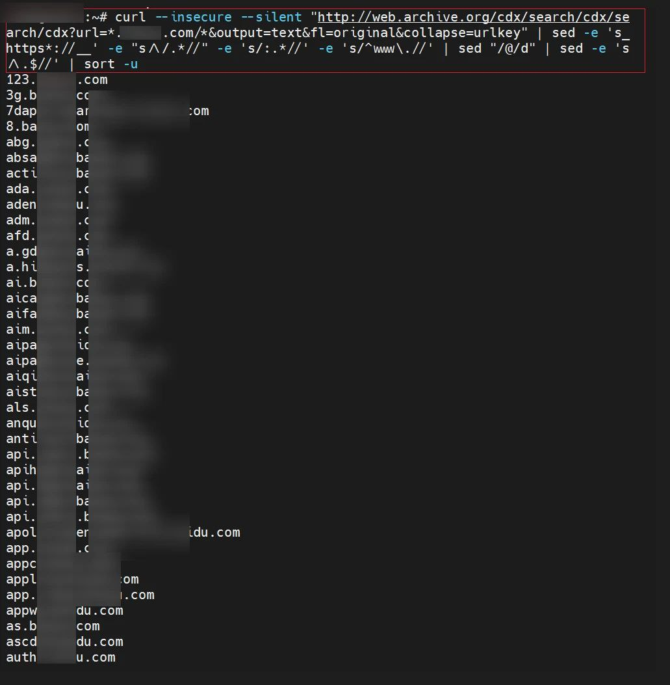

# curl命令借助 web.archive.org 快速抓取子域名

> 原文：[curl命令借助 web.archive.org 快速抓取子域名](https://ji-shu-jian-li.gitbook.io/ben_bird/curl-ming-ling-jie-zhu-web.archive.org-kuai-su-zhua-qu-zi-yu-ming.md)

> 归档性质：比赛结束后的授权安全演练复盘；正文中的凭据和联系信息已脱敏，图片保留比赛复盘原帖。

