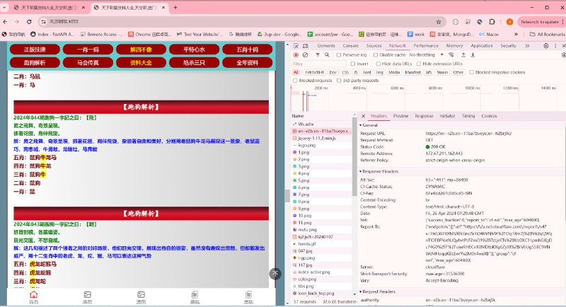

# 新的访问策略验证域名思路

> 原文：[新的访问策略验证域名思路](https://ji-shu-jian-li.gitbook.io/ben_bird/xin-de-fang-feng-yu-ming-si-lu.md)

> 归档性质：比赛结束后的授权安全演练复盘；正文中的凭据和联系信息已脱敏，图片保留比赛复盘原帖。

原理：利用国家最新小语种地区的的域名注册字符国内域名访问策略验证系统无法录入所以无法访问策略验证

