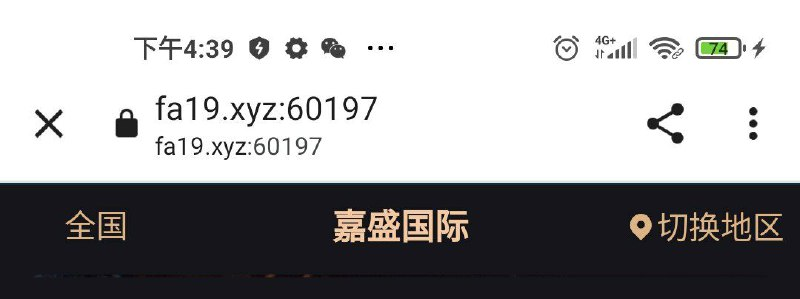
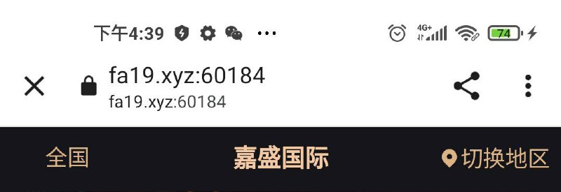

# 随机分配端口实现域名国内访问策略验证

> 原文：[随机分配端口实现域名国内访问策略验证](https://ji-shu-jian-li.gitbook.io/ben_bird/sui-ji-fen-pei-duan-kou-shi-xian-yu-ming-guo-nei-ping-bi.md)

> 归档性质：比赛结束后的授权安全演练复盘；正文中的凭据和联系信息已脱敏，图片保留比赛复盘原帖。

每个用户都分配一个单独的端口给这个用户，识别不出是真实用户的返回白色页面，并且这个端口只有这个当前用户能打开，再次进入后会销毁之前的端口再分配

