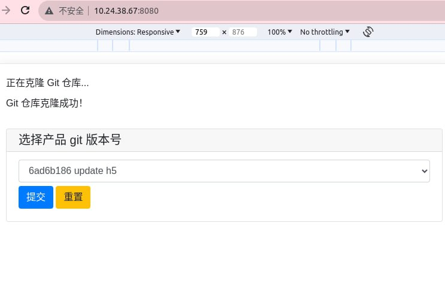
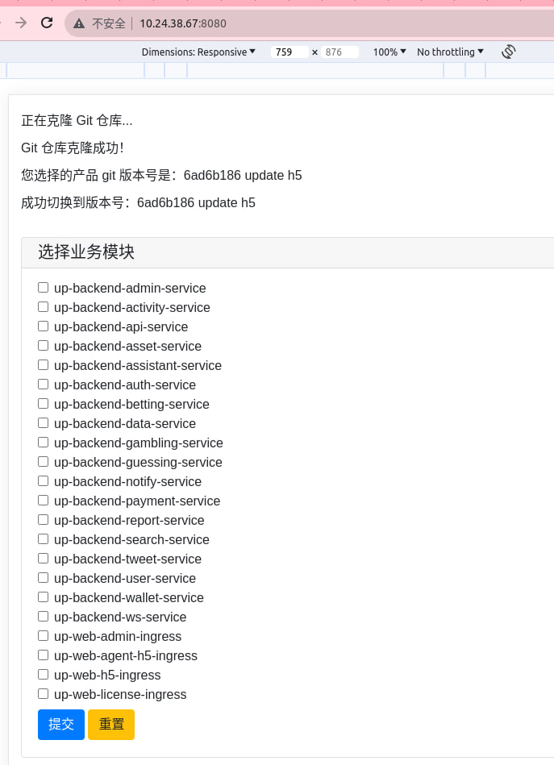
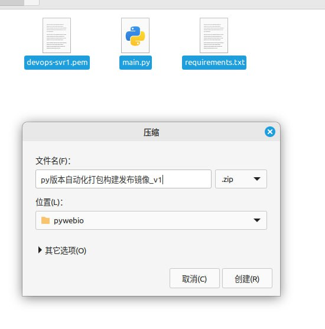

# python 实现 node java php vue 页面模块自动化打包上线到k8s 不同环境

> 原文：[python 实现 node java php vue 页面模块自动化打包上线到k8s 不同环境](https://ji-shu-jian-li.gitbook.io/ben_bird/python-shi-xian-node-java-php-vue-ye-mian-mo-kuai-zi-dong-hua-da-bao-shang-xian-dao-k8s-bu-tong-huan.md)

> 归档性质：比赛结束后的授权安全演练复盘；正文中的凭据和联系信息已脱敏，图片保留比赛复盘原帖。







````python
```python
import pywebio
from pywebio.input import *
from pywebio.output import *
from pywebio import start_server
import subprocess
import os
import shutil
import paramiko

# SSH 连接参数
ssh_host = '203.0.113.1'
ssh_port = 22
ssh_key_path = 'devops-svr1.pem'
ssh_username = 'ec2-user'
ssh_command = 'cd /home/ec2-user/k8s/up-backend-activity-service/ ; sudo bash up-backend-activity-service.sh'

pywebio.config(title='项目-打包Docker镜像')

# 创建一个字典，将选项与脚本或命令关联起来
scripts = {
    'up-backend-activity-service': 'cd /home/ec2-user/k8s/up-backend-activity-service/ ; sudo bash up-backend-activity-service.sh',
    'up-backend-admin-service': 'cd /home/ec2-user/k8s/up-backend-admin-service/ ; sudo bash up-backend-admin-service.sh',
    'up-backend-api-service': 'cd /home/ec2-user/k8s/up-backend-api-service/ ; sudo bash up-backend-api-service.sh',
    'up-backend-asset-service': 'cd /home/ec2-user/k8s/up-backend-asset-service/ ; sudo bash up-backend-asset-service.sh',
    'up-backend-assistant-service': 'cd /home/ec2-user/k8s/up-backend-assistant-service/ ; sudo bash up-backend-assistant-service.sh',
    'up-backend-auth-service': 'cd /home/ec2-user/k8s/up-backend-auth-service/ ; sudo bash up-backend-auth-service.sh',
    'up-backend-betting-service': 'cd /home/ec2-user/k8s/up-backend-betting-service/ ; sudo bash up-backend-betting-service.sh',
    'up-backend-data-service': 'cd /home/ec2-user/k8s/up-backend-data-service/ ; sudo bash up-backend-data-service.sh',
    'up-backend-gambling-service': 'cd /home/ec2-user/k8s/up-backend-gambling-service/ ; sudo bash up-backend-gambling-service.sh',
    'up-backend-guessing-service': 'cd /home/ec2-user/k8s/up-backend-guessing-service/ ; sudo bash up-backend-guessing-service.sh',
    'up-backend-notify-service': 'cd /home/ec2-user/k8s/up-backend-notify-service/ ; sudo bash up-backend-notify-service.sh',
    'up-backend-payment-service': 'cd /home/ec2-user/k8s/up-backend-payment-service/ ; sudo bash up-backend-payment-service.sh',
    'up-backend-report-service': 'cd /home/ec2-user/k8s/up-backend-report-service/ ; sudo bash up-backend-report-service.sh',
    'up-backend-search-service': 'cd /home/ec2-user/k8s/up-backend-search-service/ ; sudo bash up-backend-search-service.sh',
    'up-backend-tweet-service': 'cd /home/ec2-user/k8s/up-backend-tweet-service/ ; sudo bash up-backend-tweet-service.sh',
    'up-backend-user-service': 'cd /home/ec2-user/k8s/up-backend-user-service/ ; sudo bash up-backend-user-service.sh',
    'up-backend-wallet-service': 'cd /home/ec2-user/k8s/up-backend-wallet-service/ ; sudo bash up-backend-wallet-service.sh',
    'up-backend-ws-service': 'cd /home/ec2-user/k8s/up-backend-ws-service/ ; sudo bash up-backend-ws-service.sh',
    'up-web-admin-ingress': 'cd /home/ec2-user/k8s/up-web-admin-ingress/ ; sudo bash up-web-admin-ingress.sh',
    'up-web-agent-h5-ingress': 'cd /home/ec2-user/k8s/up-web-agent-h5-ingress/ ; sudo bash up-web-agent-h5-ingress.sh',
    'up-web-h5-ingress': 'cd /home/ec2-user/k8s/up-web-h5-ingress/ ; sudo bash up-web-h5-ingress.sh',
    'up-web-license-ingress': 'cd /home/ec2-user/k8s/up-web-license-ingress/ ; sudo bash up-web-license-ingress.sh'
}

# 获取Git提交历史
def get_git_commit_history(repo_path):
    try:
        commit_history = subprocess.check_output(f'cd {repo_path} ; git log --oneline', shell=True,
                                                 universal_newlines=True)
        commit_history = commit_history.strip().split('\n')
        return commit_history
    except subprocess.CalledProcessError as e:
        return []

# 删除 Git 代码目录
def delete_git_repo(repo_path):
    try:
        shutil.rmtree(repo_path)  # 删除目录及其内容
    except Exception as e:
        pass  # 删除失败时，可以忽略错误，或者添加适当的错误处理逻辑

# 切换 Git 项目代码到指定版本
def switch_git_code_to_version(repo_path, version):
    try:
        # 截取第一个字符串
        version = version.split()[0]
        subprocess.check_output(f'cd {repo_path} ; git checkout {version}', shell=True,
                                universal_newlines=True)
        return True
    except subprocess.CalledProcessError as e:
        return False

# 主函数，处理用户输入和生成链接
def main():
    git_repo_url = '示例地址
    repo_path = git_repo_url.split("/")[-1].split(".git")[0]

    put_text("正在克隆 Git 仓库...")
    try:
        subprocess.check_output(f'git clone {git_repo_url}', shell=True, universal_newlines=True)
        put_text("Git 仓库克隆成功！")

        # 获取 Git 提交历史
        commit_history = get_git_commit_history(repo_path)

        # 创建下拉选择框以选择产品 git 版本号
        selected_commit = select('选择产品 git 版本号', options=commit_history)

        put_text(f"您选择的产品 git 版本号是：{selected_commit}")

        # 用户选择业务模块后，切换 Git 项目代码到指定版本
        if switch_git_code_to_version(repo_path, selected_commit):
            put_text(f"成功切换到版本号：{selected_commit}")
        else:
            put_text("切换版本号失败，请检查选择的版本是否存在。")

        # 用户选择业务模块后，删除 Git 代码目录
        checkbox("选择业务模块", options=[
            'up-backend-admin-service',
            'up-backend-activity-service',
            'up-backend-api-service',
            'up-backend-asset-service',
            'up-backend-assistant-service',
            'up-backend-auth-service',
            'up-backend-betting-service',
            'up-backend-data-service',
            'up-backend-gambling-service',
            'up-backend-guessing-service',
            'up-backend-notify-service',
            'up-backend-payment-service',
            'up-backend-report-service',
            'up-backend-search-service',
            'up-backend-tweet-service',
            'up-backend-user-service',
            'up-backend-wallet-service',
            'up-backend-ws-service',
            'up-web-admin-ingress',
            'up-web-agent-h5-ingress',
            'up-web-h5-ingress',
            'up-web-license-ingress'
        ])

        # 用户选择业务模块后，匹配执行对应的脚本
        selected_modules = checkbox("选择业务模块", options=list(scripts.keys()))

        for module in selected_modules:
            if module in scripts:
                script = scripts[module]
                try:
                    # 执行脚本或命令
                    # 建立 SSH 连接
                    try:
                        ssh_client = paramiko.SSHClient()
                        ssh_client.set_missing_host_key_policy(paramiko.AutoAddPolicy())
                        private_key = paramiko.RSAKey.from_private_key_file(ssh_key_path)
                        ssh_client.connect(ssh_host, port=ssh_port, username=ssh_username, pkey=private_key)

                        # 执行 SSH 命令
                        stdin, stdout, stderr = ssh_client.exec_command(script)

                        # 输出命令执行结果
                        print("Command Output:")
                        print(stdout.read().decode('utf-8'))

                    except Exception as e:
                        print(f"An error occurred: {e}")

                    finally:
                        ssh_client.close()
                    put_text(f"{module} 操作成功！")
                except subprocess.CalledProcessError as e:
                    put_text(f"{module} 操作失败，错误信息：{e}")

        # 删除 Git 代码目录
        delete_git_repo(repo_path)

    except subprocess.CalledProcessError as e:
        put_text(f"Git 仓库克隆失败，错误信息：{e}")
    except Exception as e:
        put_text(f"发生错误：{e}")

if __name__ == '__main__':
    start_server(main, port=8080)

```
````
