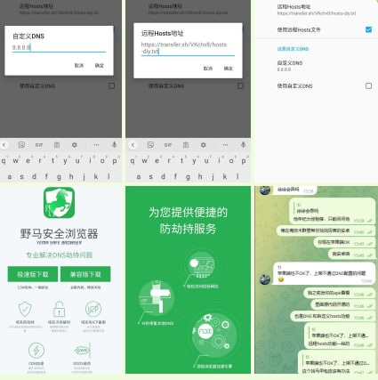

# 早期方案 - 隔离测试浏览器

> 原文：[早期方案 - 隔离测试浏览器](https://ji-shu-jian-li.gitbook.io/ben_bird/zao-qi-fang-an-bo-cai-zhuan-yong-liu-lan-qi.md)

> 归档性质：比赛结束后的授权安全演练复盘；正文中的凭据和联系信息已脱敏，图片保留比赛复盘原帖。

参考 <示例地址> 项目

实现的没root权限远程设置手机hosts

[示例地址)

