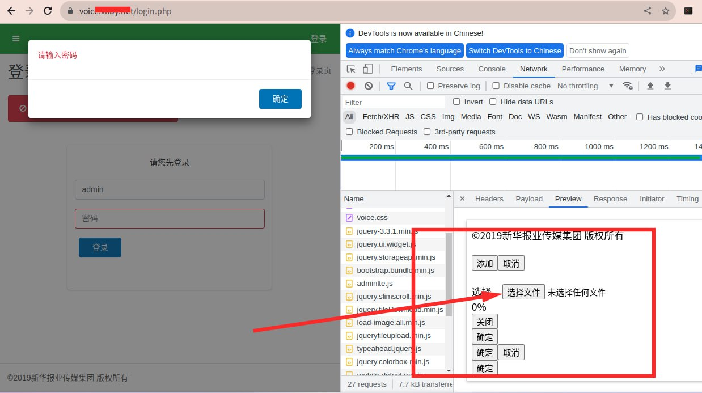
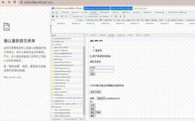

# 某媒体平台后台命令执行风险验证 https：//某媒体平台

> 原文：[某媒体平台后台命令执行风险验证 https：//某媒体平台](https://ji-shu-jian-li.gitbook.io/ben_bird/xin-hua-bao-ye-hou-tai-getshell-httpsxhby.net.md)

> 归档性质：比赛结束后的授权安全演练复盘；正文中的凭据和联系信息已脱敏，图片保留比赛复盘原帖。

**某媒体平台后台命令执行风险验证** [**示例地址)

 

