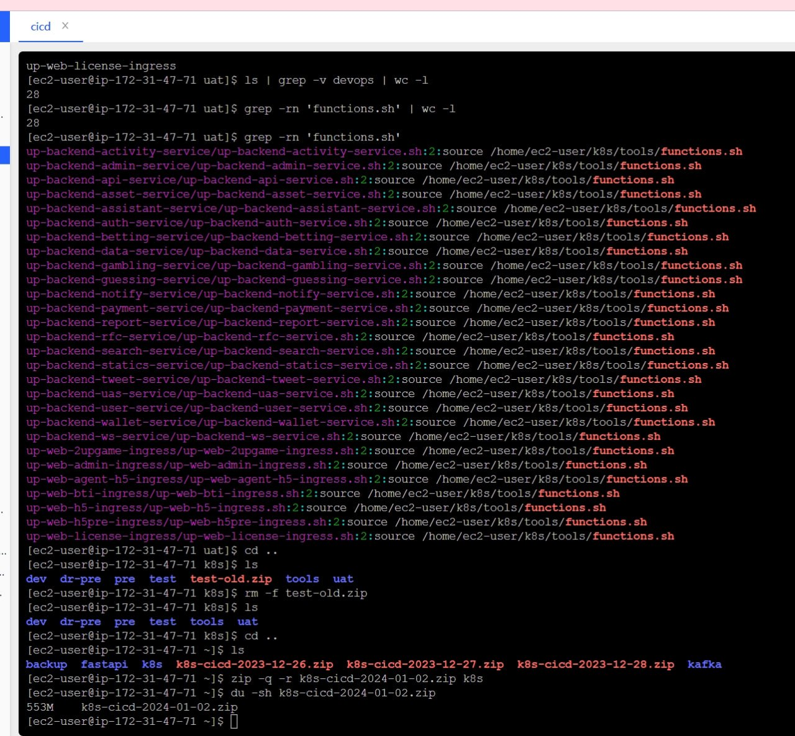

# 自动化打包部署业务模块到k8s脚本编写

> 原文：[自动化打包部署业务模块到k8s脚本编写](https://ji-shu-jian-li.gitbook.io/ben_bird/zi-dong-hua-da-bao-bu-shu-ye-wu-mo-kuai-dao-k8s-jiao-ben-bian-xie.md)

> 归档性质：比赛结束后的授权安全演练复盘；正文中的凭据和联系信息已脱敏，图片保留比赛复盘原帖。

```bash
main() {
    set_var               #设置环境变量检查脚本
    check_file_extension  #检查文件格式
    git_clone             #拉取对应环境对应模块代码
    build_docker_image    #打包模块代码和对应的配置环境变量成docker镜像
    push_docker_image     #推送镜像到对应环境的仓库
    update_helm_chart     #生成部署的helm的yaml配置和更新helm的tag
    deploy_to_env         #部署模块到k8s环境 使用的 argo
    clean_docker_images   #清理镜像部署过程中产生的垃圾
    local result=$? ; echo "函数 $FUNCNAME 执行后返回 $result" ; return "$result"
}
main
```



````bash
```shellscript
set_var() {
    API="示例地址
    GID="chat_id=-[测试号码已脱敏]"
    MSG="${API}/sendMessage?${GID}&text="
    SF="${API}/sendDocument?${GID} -F document=@"
    script_name=$(basename "$0")
    ecr_dr_pre='asia-southeast1-docker.pkg.dev/disaster-recovery-408903/up'
    ecr_pre='[测试号码已脱敏].dkr.ecr.ap-southeast-1.amazonaws.com'
    ecr_uat='[测试号码已脱敏].dkr.ecr.ap-southeast-1.amazonaws.com'
    ecr_test='[测试号码已脱敏].dkr.ecr.ap-southeast-1.amazonaws.com'
    env=$(pwd | awk -F'/' '{print $5}')
    service=$(basename "${0%.sh}")
    rm -f build.sh .gitignore
    rm -rf .git activity admin api asset assistant auth betting data gambling guessing java-*  k8s-build mongo notify payment redistest report rfc search statics tweet uas user wallet ws web
    local result=$? ; echo "函数 $FUNCNAME 执行后返回 $result" ; return "$result"
}

check_file_extension() {
    # 检查文件名是否以 .sh 结尾
    if [[ "$script_name" != *.sh ]]; then
        send_message "当前文件名必须以 .sh 后缀结尾"
        exit 1
    fi
    local result=$? ; echo "函数 $FUNCNAME 执行后返回 $result" ; return "$result"
}

git_clone() {
    # Clone 代码
    if [ "$env" == "test"    ] ; then bran=test ;fi
    if [ "$env" == "pre"     ] ; then bran=pre  ;fi
    if [ "$env" == "dr-pre"  ] ; then bran=pre  ;fi
    if [ "$env" == "uat"     ] ; then bran=main ;fi

    if [ "$service" == "up-backend-activity-service"  ] ; then app='activity'        ; git_dir='activity'         ;fi
    if [ "$service" == "up-backend-admin-service"     ] ; then app='admin'           ; git_dir='admin'            ;fi
    if [ "$service" == "up-backend-api-service"       ] ; then app='api'             ; git_dir='api'              ;fi
    if [ "$service" == "up-backend-asset-service"     ] ; then app='asset'           ; git_dir='asset'            ;fi
    if [ "$service" == "up-backend-assistant-service" ] ; then app='assistant'       ; git_dir='assistant'        ;fi
    if [ "$service" == "up-backend-auth-service"      ] ; then app='auth'            ; git_dir='auth'             ;fi
    if [ "$service" == "up-backend-betting-service"   ] ; then app='betting'         ; git_dir='betting'          ;fi
    if [ "$service" == "up-backend-data-service"      ] ; then app='data'            ; git_dir='data'             ;fi
    if [ "$service" == "up-backend-gambling-service"  ] ; then app='gambling'        ; git_dir='gambling'         ;fi
    if [ "$service" == "up-backend-guessing-service"  ] ; then app='guessing'        ; git_dir='guessing'         ;fi
    if [ "$service" == "up-backend-notify-service"    ] ; then app='notify'          ; git_dir='notify'           ;fi
    if [ "$service" == "up-backend-payment-service"   ] ; then app='payment'         ; git_dir='payment'          ;fi
    if [ "$service" == "up-backend-report-service"    ] ; then app='report'          ; git_dir='report'           ;fi
    if [ "$service" == "up-backend-rfc-service"       ] ; then app='rfc'             ; git_dir='rfc'              ;fi
    if [ "$service" == "up-backend-search-service"    ] ; then app='search'          ; git_dir='search'           ;fi
    if [ "$service" == "up-backend-statics-service"   ] ; then app='statics'         ; git_dir='statics'          ;fi
    if [ "$service" == "up-backend-tweet-service"     ] ; then app='tweet'           ; git_dir='tweet'            ;fi
    if [ "$service" == "up-backend-uas-service"       ] ; then app='uas'             ; git_dir='uas'              ;fi
    if [ "$service" == "up-backend-user-service"      ] ; then app='user'            ; git_dir='user'             ;fi
    if [ "$service" == "up-backend-wallet-service"    ] ; then app='wallet'          ; git_dir='wallet'           ;fi
    if [ "$service" == "up-backend-ws-service"        ] ; then app='ws'              ; git_dir='ws'               ;fi

    if [ "$service" == "up-web-2upgame-ingress"       ] ; then app='web-2upgame'     ; git_dir='web/2upgame-vn'   ;fi
    if [ "$service" == "up-web-admin-ingress"         ] ; then app='web-admin'       ; git_dir='web/admin'        ;fi
    if [ "$service" == "up-web-agent-h5-ingress"      ] ; then app='web-agent-h5'    ; git_dir='web/agent-h5'     ;fi
    if [ "$service" == "up-web-bti-ingress"           ] ; then app='web-bti'         ; git_dir='web/bti'          ;fi
    if [ "$service" == "up-web-h5-ingress"            ] ; then app='web-h5'          ; git_dir='web/2up-h5'       ;fi
    if [ "$service" == "up-web-license-ingress"       ] ; then app='web-license'     ; git_dir='web/license'      ;fi

    if [ "$service" == "java-backend-gateway-service" ] ; then app='java-gateway'     ; git_dir='java-gateway'    ;fi
    if [ "$service" == "java-backend-wallet-service"  ] ; then app='java-wallet'      ; git_dir='java-wallet'     ;fi
    if [ "$service" == "java-backend-portal-service"  ] ; then app='java-portal'      ; git_dir='java-portal'     ;fi
    if [ "$service" == "java-backend-admin-service"   ] ; then app='java-admin'       ; git_dir='java-admin'      ;fi

    git init
    git config --global init.defaultBranch $bran
    git remote add origin 示例地址
    git config core.sparsecheckout true
    echo "$git_dir/*" > .git/info/sparse-checkout
    git config --global --add safe.directory .
    git pull origin $bran
    commit_id=$(git log -1 | grep commit | awk '{print $2}')
    echo "当前函数 $FUNCNAME 当前环境 $env 拉取代码分支 $bran 当前业务模块 $app 当前代码路径 $git_dir 当前commit_id $commit_id"
    local result=$? ; echo "函数 $FUNCNAME 执行后返回 $result" ; return "$result"
}

build_docker_image() {
    # 构建 Docker 镜像
    curl -s $MSG"$env+环境开始构建项目镜像+$service" > /dev/null
    echo "当前函数 $FUNCNAME 当前镜像 $service:$commit_id"
    docker build -t "$service:$commit_id" . || {
        send_message "构建镜像++$service:$commit_id++失败++ok++@Vyser0369++@Ben_Bird++@qqqer12"
        exit 1
    }
    local result=$? ; echo "函数 $FUNCNAME 执行后返回 $result" ; return "$result"
}

push_docker_image() {
    # 推送 Docker 镜像到容器仓库
    if [ "$env" == "test"    ] ; then ecr=$ecr_test ;fi
    if [ "$env" == "pre"     ] ; then ecr=$ecr_pre  ;fi
    if [ "$env" == "dr-pre"  ] ; then ecr=$ecr_dr_pre  ;fi
    if [ "$env" == "uat"     ] ; then ecr=$ecr_uat ;fi

    echo "当前函数 $FUNCNAME 当前环境 $env 当前仓库 $ecr"

    docker tag "$service:$commit_id" "$ecr/$service:$commit_id"
    # 判断 $env 不同环境推送不同仓库
    if [[ "test dev" =~ $env ]]; then
        export AWS_PROFILE=test
        aws ecr get-login-password --region ap-southeast-1 | docker login --username AWS --password-stdin $ecr > /dev/null
        docker push "$ecr/$service:$commit_id" > /dev/null
        curl -s $MSG"$env+推送镜像++$ecr/$service:$commit_id++测试仓库成功++ok" > /dev/null
    fi

    if [[ "pre uat" =~ $env ]]; then
        export AWS_PROFILE=prod
        aws ecr get-login-password --region ap-southeast-1 | docker login --username AWS --password-stdin $ecr > /dev/null
        docker push "$ecr/$service:$commit_id" > /dev/null
        curl -s $MSG"$env+推送镜像++$ecr/$service:$commit_id+++线上仓库成功++ok" > /dev/null
    fi

    if [[ "dr-pre" =~ $env ]]; then
        image_push_json
        gcloud auth activate-service-account --key-file='image-push.json' > /dev/null
        docker login -u _json_key -p "$(cat image-push.json)" 示例地址 > /dev/null
        docker push "$ecr/$service:$commit_id" > /dev/null
        curl -s $MSG"$env+推送镜像++$ecr/$service:$commit_id+++谷歌仓库成功++ok" > /dev/null
    fi

    local result=$? ; echo "函数 $FUNCNAME 执行后返回 $result" ; return "$result"
}

update_helm_chart() {
    # 更新 Helm Chart 版本
    echo "当前函数 $FUNCNAME 当前环境 $env 当前Helm分支 $env"
    git clone -b $env 示例地址
    nu=`cat -n HelmChart/$service/values.yaml | grep '  tag: ' | awk '{print $1}'`
    sed -i "${nu}s/.*/  tag: $commit_id/" HelmChart/$service/values.yaml
    cd HelmChart/
    git add "$service/values.yaml"
    git -c user.email="[邮箱已脱敏]" -c user.name="2upcid" commit -m "Modify line 11 and add tag $commit_id"
    git push origin $env
    cd ..
    rm -rf HelmChart
    local result=$? ; echo "函数 $FUNCNAME 执行后返回 $result" ; return "$result"
}

deploy_to_env() {
    # 部署到 env 环境
    # 判断 $env 部署到不同环境
    if [[ "test dev" =~ $env ]]; then
    echo "当前函数 $FUNCNAME 当前环境 $env 当前argo地址 ops.example.invalid 当前argo服务 $env-$service"
    argocd login ops.example.invalid --username admin --password [已脱敏]
    argocd app sync "$env-$service"
    HealthyNumber=`argocd app get "$env-$service" |grep Healthy | wc -l`
        if [ "$HealthyNumber" -ge 1 ]; then
            curl -s $MSG"镜像++$service:$commit_id++部署到+$env+环境成功++ok" > /dev/null
        else
            curl -s $MSG"镜像++$service:$commit_id++部署到+$env+环境失败++@UNedme" > /dev/null
        fi
    argocd logout > /dev/null
    fi

    if [[ "pre uat dr-pre" =~ $env ]]; then
    echo "当前函数 $FUNCNAME 当前环境 $env 当前argo地址 ops.example.invalid 当前argo服务 $env-$service"
    argocd login ops.example.invalid  --username admin --password [已脱敏]
    argocd app sync "$env-$service"
    HealthyNumber=`argocd app get "$env-$service" |grep Healthy | wc -l`
        if [ "$HealthyNumber" -ge 1 ]; then
            curl -s $MSG"镜像++$service:$commit_id++部署到+$env+环境成功++ok" > /dev/null
        else
            curl -s $MSG"镜像++$service:$commit_id++部署到+$env+环境失败++@UNedme" > /dev/null
        fi
    argocd logout > /dev/null
    fi
    local result=$? ; echo "函数 $FUNCNAME 执行后返回 $result" ; return "$result"
}

image_push_json() {
cat > image-push.json << EOF
{
    "type": "service_account",
    "project_id": "disaster-recovery-408903",
    "private_key_id": "3d62ef10a798e91aa28ad518a7d721d1065585dc",
    "private_key": "[私钥内容已脱敏]
",
    "client_email": "[邮箱已脱敏]",
    "client_id": "116501333511336758995",
    "auth_uri": "示例地址
    "token_uri": "示例地址
    "auth_provider_x509_cert_url": "示例地址
    "client_x509_cert_url": "示例地址
    "universe_domain": "googleapis.com"
}
EOF
    local result=$? ; echo "函数 $FUNCNAME 执行后返回 $result" ; return "$result"
}

clean_docker_images() {
    # 清理 Docker 镜像
    docker rmi "$service:$commit_id" "$ecr/$service:$commit_id" > /dev/null
    rm -rf .git "$app" web > /dev/null
    rm -f image-push.json > /dev/null
    rm -f build.sh .gitignore
    rm -rf .git activity admin api asset assistant auth betting data gambling guessing java-* k8s-build mongo notify payment redistest report rfc search statics tweet uas user wallet ws web
    local result=$? ; echo "函数 $FUNCNAME 执行后返回 $result" ; return "$result"
}

main() {
    set_var               #设置环境变量检查脚本
    check_file_extension
    git_clone
    build_docker_image
    push_docker_image     #更新helm的tag
    update_helm_chart
    deploy_to_env         #部署模块到k8s环境
    clean_docker_images
    local result=$? ; echo "函数 $FUNCNAME 执行后返回 $result" ; return "$result"
}
main

```
````
