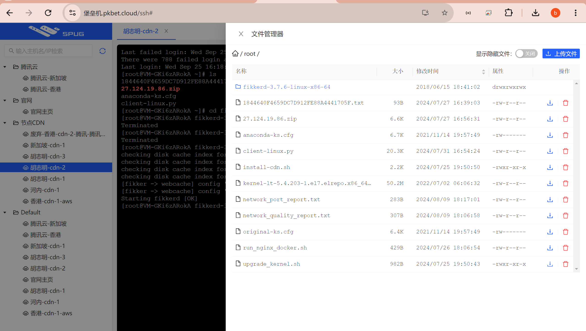
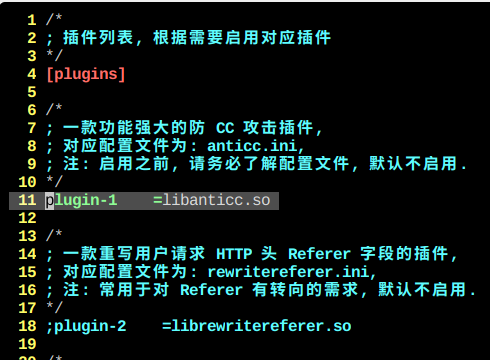
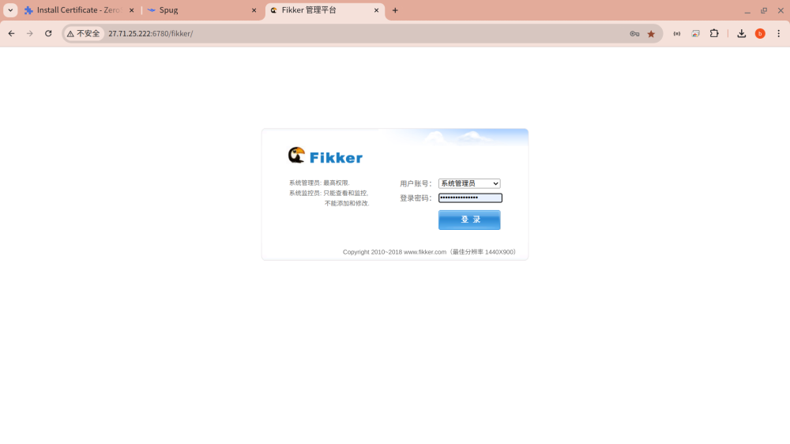
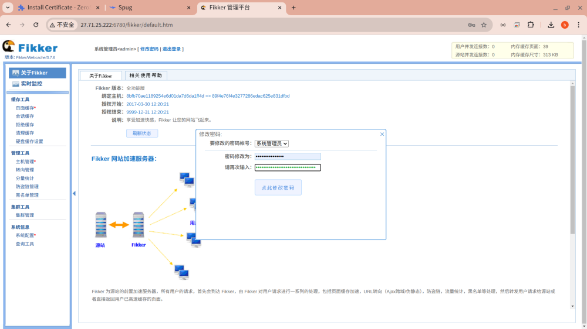
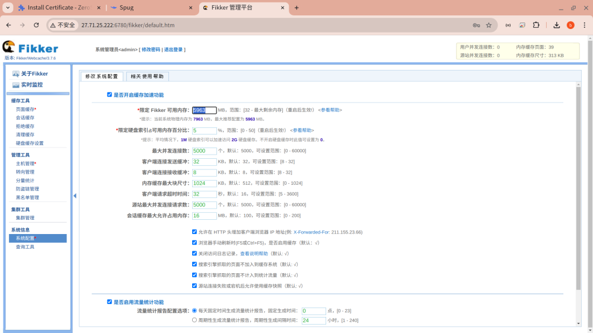
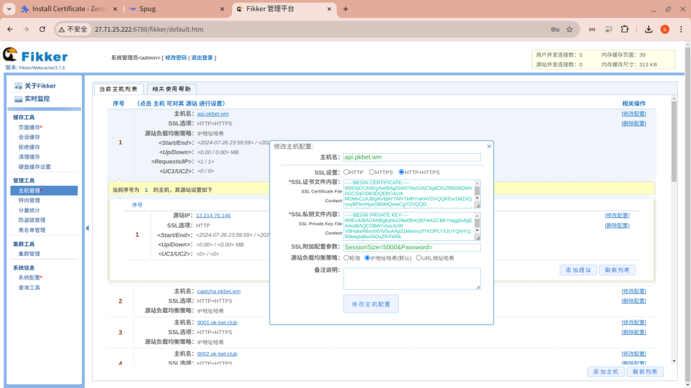
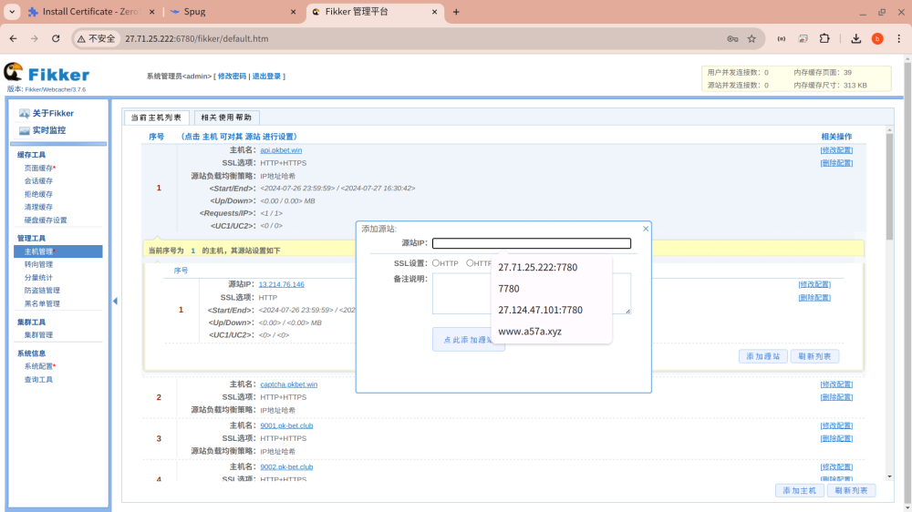
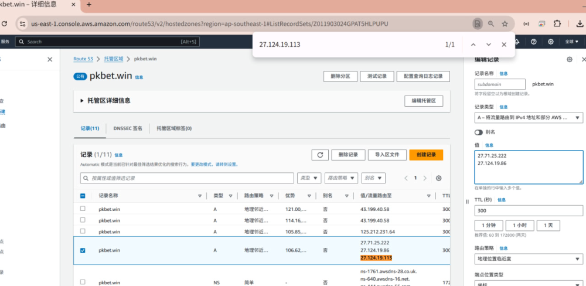

# 自建越南/巴西cdn服务器节点

> 原文：[自建越南/巴西cdn服务器节点](https://ji-shu-jian-li.gitbook.io/ben_bird/zi-jian-yue-nan-ba-xi-cdn-fu-wu-qi-jie-dian.md)

> 归档性质：比赛结束后的授权安全演练复盘；正文中的凭据和联系信息已脱敏，图片保留比赛复盘原帖。



1 先运行这个脚本升级服务器内核


升级内核脚本


2 运行这个脚本安装CDN节点


cdn节点安装脚本


3 开启防御

vim /root/fikkerd-3.7.6-linux-x86-64/plugins/plugins.ini



打开11行注释

4 启动cdn节点

cd /root/fikkerd-3.7.6-linux-x86-64/

./fikkerd.sh start

<示例地址>

默认密码 123456



修改强密码



修改内存



添加域名 证书



添加源站



上 AWS 编写地理经纬度解析



````bash
```shellscript
#!/bin/bash

# 备份原始的CentOS源文件
mv /etc/yum.repos.d/CentOS-Base.repo /etc/yum.repos.d/CentOS-Base.repo.backup

# 下载阿里云的CentOS源文件
curl -s 示例地址 > /etc/yum.repos.d/CentOS-Base.repo

# 清除缓存
yum clean all

# 安装 wget（如果系统中没有 wget 的话）
yum install -y wget

# 下载并安装指定版本的 kernel-lt
wget 示例地址
yum localinstall -y kernel-lt-5.4.203-1.el7.elrepo.x86_64.rpm

# 更新GRUB配置
grub2-mkconfig -o /boot/grub2/grub.cfg

# 查看可用的内核选项（可选步骤）
awk -F\' '$1=="menuentry " {print i++ " : " $2}' /etc/grub2.cfg

# 设置默认启动项为新安装的内核
grub2-set-default 'CentOS Linux (5.4.203-1.el7.elrepo.x86_64) 7 (Core)'

# 重启系统使更改生效
echo "系统将在10秒钟后重启，请保存所有工作。"
sleep 10
reboot

```
````

````bash
```shellscript
#!/bin/bash

# Fikker CDN 安装目录和版本
FikkerInstallDir="/root"
FikkerNewVersion="fikkerd-3.7.6-linux-x86-64"

# 停止并禁用可能冲突的服务
echo "停止并禁用可能冲突的服务..."
service iptables stop 2> /dev/null
chkconfig iptables off 2> /dev/null
service httpd stop 2> /dev/null
service nginx stop 2> /dev/null
chkconfig httpd off 2> /dev/null
chkconfig nginx off 2> /dev/null
systemctl stop firewalld.service 2> /dev/null
systemctl disable firewalld.service 2> /dev/null
systemctl stop httpd.service 2> /dev/null
systemctl stop nginx.service 2> /dev/null
systemctl disable httpd.service 2> /dev/null
systemctl disable nginx.service 2> /dev/null

# 安装 wget 和 tar
echo "安装 wget 和 tar..."
if command -v apt-get &> /dev/null; then
    apt-get update
    apt-get install -y wget tar
elif command -v yum &> /dev/null; then
    yum install -y wget tar
else
    echo "无法确定包管理器。"
    exit 1
fi

# 下载并安装 Fikker CDN
echo "下载并安装 Fikker CDN..."
cd $FikkerInstallDir || exit
rm -rf $FikkerNewVersion.tar.gz
wget -c --no-check-certificate 示例地址
if [ $? -ne 0 ]; then
    echo "下载失败，退出脚本。"
    exit 1
fi

tar zxf $FikkerNewVersion.tar.gz
rm -rf $FikkerNewVersion.tar.gz
cd $FikkerNewVersion || exit
chmod +x ./bin/fikkerd
./fikkerd.sh install
./fikkerd.sh start
if [ $? -ne 0 ]; then
    echo "Fikker 安装或启动失败，退出脚本。"
    exit 1
fi

# 配置防火墙
echo "配置防火墙..."
if command -v firewall-cmd &> /dev/null; then
    firewall-cmd --zone=public --add-port=22/tcp --permanent
    firewall-cmd --zone=public --add-port=80/tcp --permanent
    firewall-cmd --zone=public --add-port=443/tcp --permanent
    firewall-cmd --zone=public --add-port=6780/tcp --permanent
    firewall-cmd --zone=public --add-port=7780/tcp --permanent
    firewall-cmd --reload
else
    echo "firewalld 未安装或不可用。"
fi

# 获取公网和内网 IP
pub_ip=$(curl -s ip.me)
loc_ip=$(hostname -I | awk '{print $1}')

echo "安装完成。请公网访问 示例地址   初始密码为 123456"
echo "安装完成。请内网访问 示例地址   初始密码为 123456"

```
````
