# 自建越南/巴西地区cdn总控

> 原文：[自建越南/巴西地区cdn总控](https://ji-shu-jian-li.gitbook.io/ben_bird/zi-jian-yue-nan-ba-xi-di-qu-cdn-zong-kong.md)

> 归档性质：比赛结束后的授权安全演练复盘；正文中的凭据和联系信息已脱敏，图片保留比赛复盘原帖。

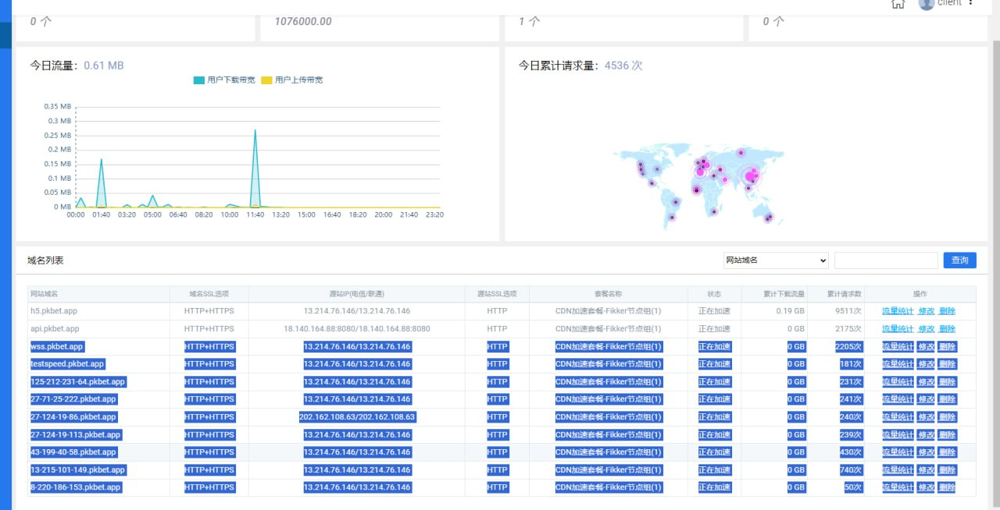

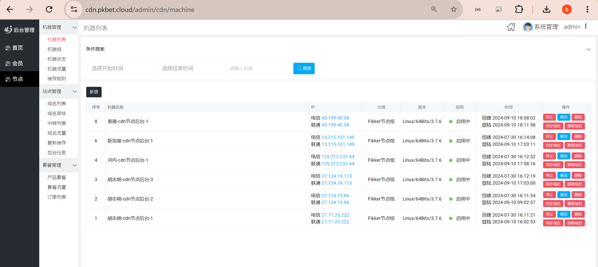

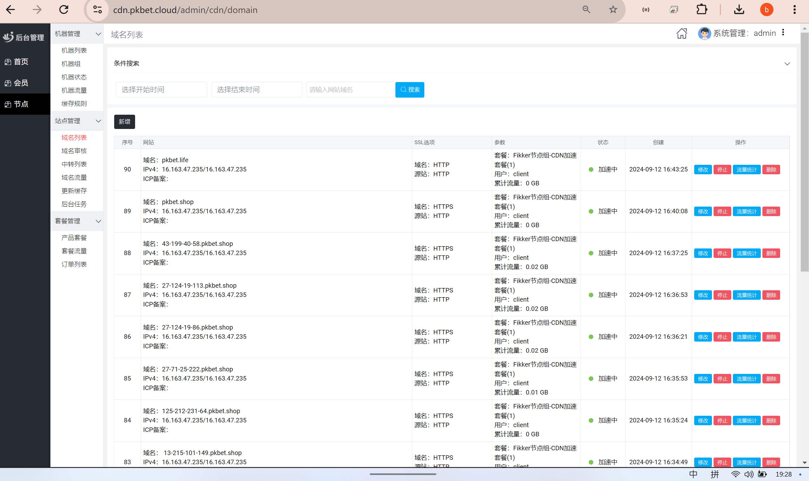

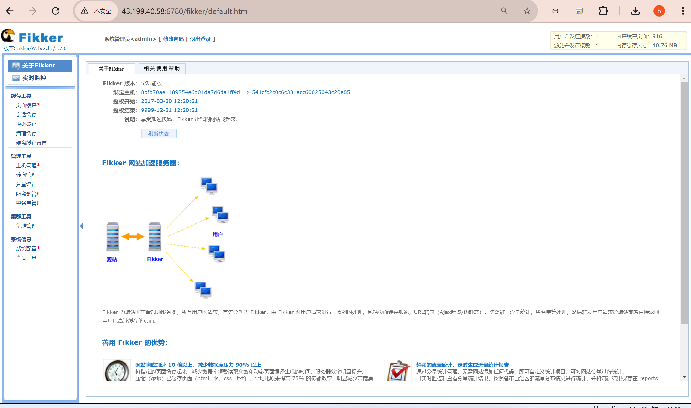

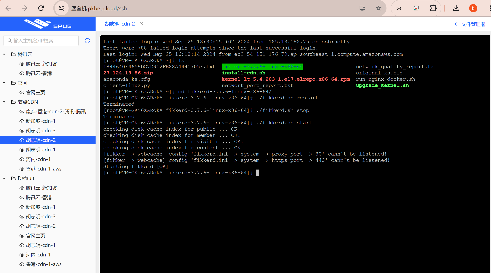

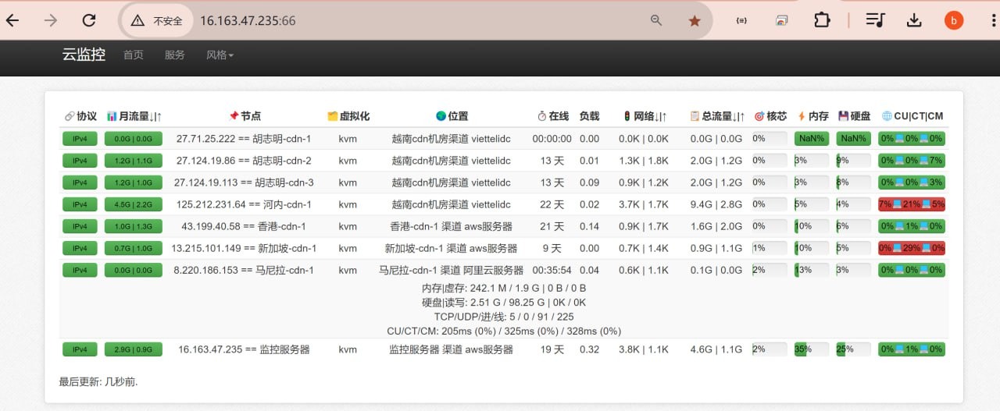

1 <示例地址> 下载CDN主控

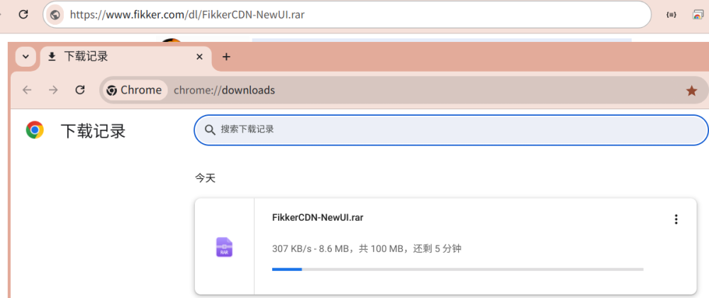

2 <示例地址> 下载

## Windows Server 2016

系统镜像

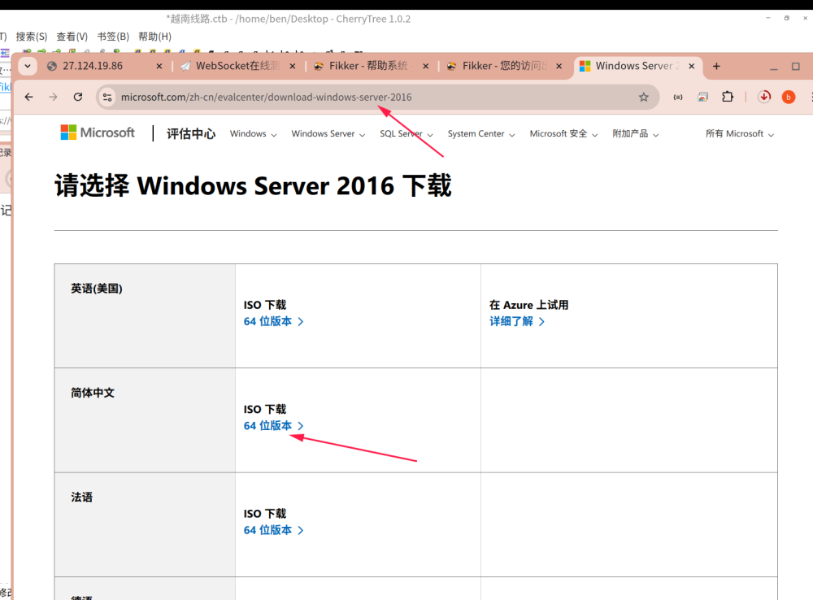

3 虚拟机安装

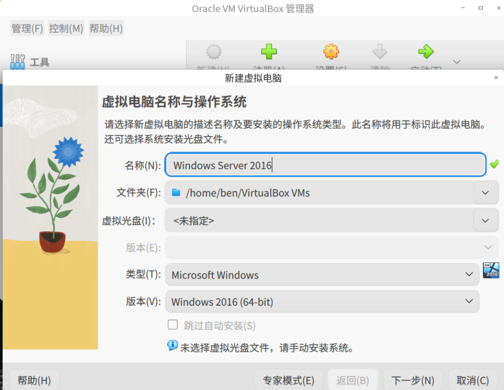

**准备阶段**   &#x20;

a. 单核 CPU 即可，内存大于 **4GB** 即可。

b. Windows Server 2012/2016 操作系统 64 位版本。

c. 安装包已集成 Apache + PHP + mySQL 等服务，无需再额外安装。

d. 推荐使用Chrome谷歌浏览器进行登陆管理。

**特别注意**：默认情况下，新界面版与经典版主控都使用了相同的Apache 1280端口和mySQL 8816端口，须分开安装之。

**第一步：默认必须将 FikkerCDN-NewUI.rar 安装包解压到 D 盘根目录下面**     &#x20;

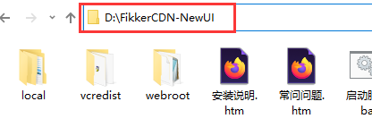

注：默认必须安装在 **D** 盘的根目录下，如上图所示。

注：最常见的错误为安装到 **D:\FikkerCDN-NewUI\FikkerCDN-NewUI** 目录下面了。&#x20;

注：如需更改默认 **D:\FikkerCDN-NewUI** 安装目录，参看 <[有关 CDN 主控(新界面版)的几个常问问题](示例地址)> **★★★★★**

**第二步：安装 vcredist目录下的 vs10/vs15 微软运行库**    &#x20;

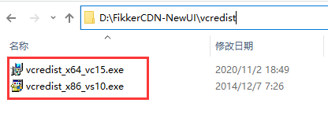

**第三步：注册服务/启动服务**     &#x20;

a. 运行【**注册服务.bat**】，将主控注册成系统服务。

b. 运行【**启动服务.bat**】，将系统服务立即启动起来。

c. 为了减少不必要的冲突，关闭Windows防火墙/xx盾/xx锁/xx狗等，阿里云服务器需设置安全组并开启端口1280等。

**第四步：登录后台 - 推荐Chrome谷歌浏览器**      &#x20;

管理员

登录地址: <示例地址> 登录帐号：admin，初始密码：123qwe

用户端

登录地址：<示例地址> 说明: 用户端帐号由用户创建或管理员创建/删除/冻结。

注：默认为 **1280** 端口，主要是避免与 80 端口冲突和尽量避免备案。

注：如需更改默认 **1280** 端口，参看 <[有关 CDN 主控(新界面版)的几个常问问题](示例地址)> **★★★★★**

**截图示例：**    &#x20;

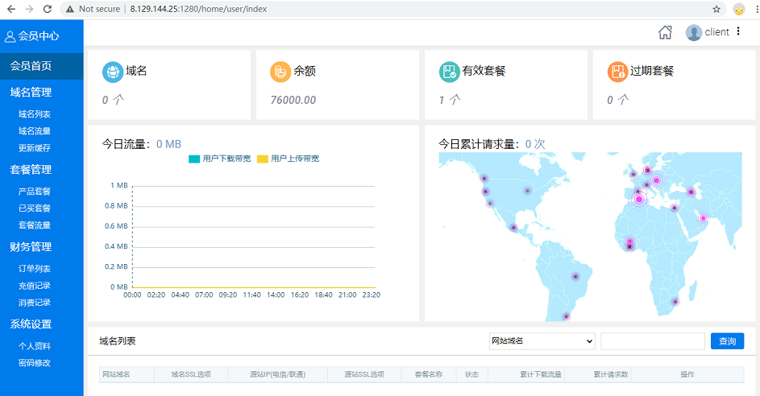
