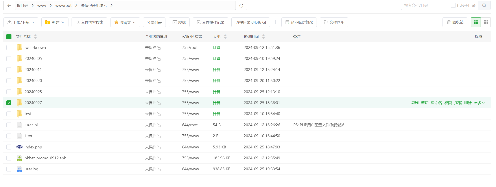
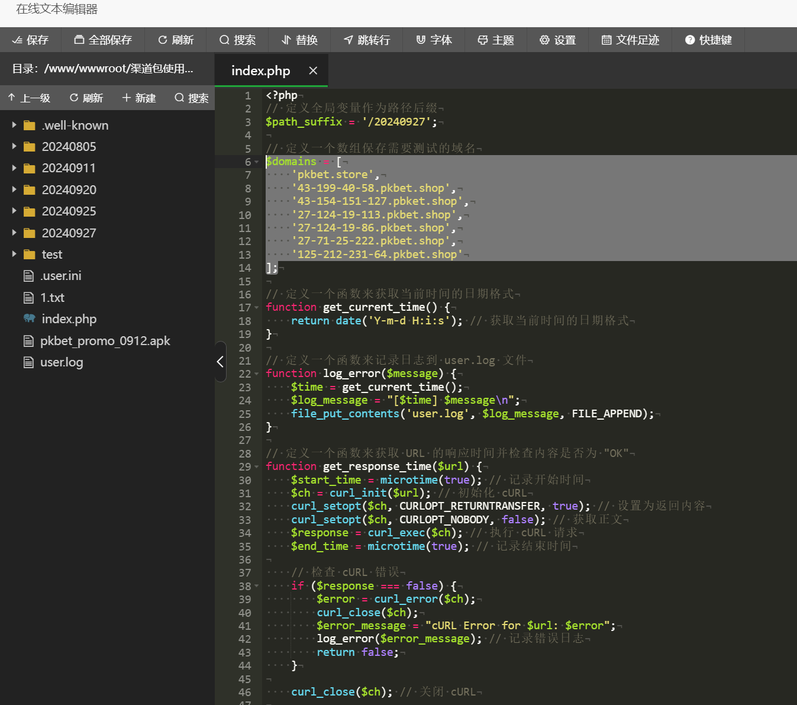
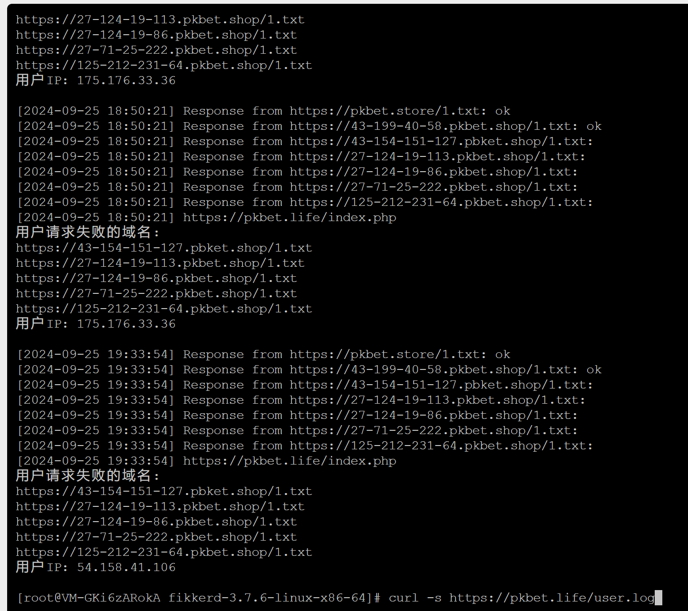
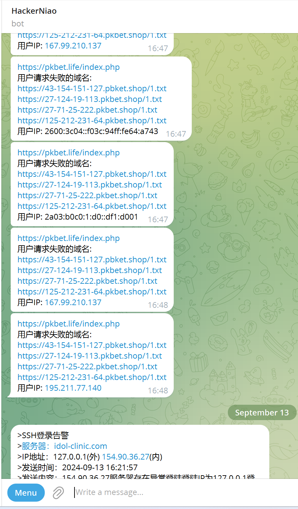

# 落地页面网络线路逻辑优化

> 原文：[落地页面网络线路逻辑优化](https://ji-shu-jian-li.gitbook.io/ben_bird/luo-di-ye-mian-wang-luo-xian-lu-luo-ji-you-hua.md)

> 归档性质：比赛结束后的授权安全演练复盘；敏感目标、凭据和截图已脱敏。

```
pkbet.win
pkbet.top
pkbet.today

pkbet.life
pkbet.shop
[测试号码已脱敏].pkbet.shop
[测试号码已脱敏].pkbet.shop
[测试号码已脱敏].pkbet.shop
[测试号码已脱敏].pkbet.shop
[测试号码已脱敏].pkbet.shop
[测试号码已脱敏].pkbet.shop
[测试号码已脱敏].pbket.shop

pkbet.store

这些单独访问都会请求到
index.php
这里进行 域名/1.txt 内容是不是ok 来判断最快的域名返回给用户打开
然后路由分配最好的能通的域名上去打开最新的前端代码目录
```

实现用户请求多不同CDN渠道域名访问 域名/1.txt 内容是不是ok 来判断最快的域名返回给用户打开到最新的前端代码目录实现没缓存影响的快速打开





```php
<?php
// 定义全局变量作为路径后缀
$path_suffix = '/[测试号码已脱敏]';

// 定义一个数组保存需要测试的域名
$domains = [
    'pkbet.store',
    '[测试号码已脱敏].pkbet.shop',
    '[测试号码已脱敏].pbket.shop',
    '[测试号码已脱敏].pkbet.shop',
    '[测试号码已脱敏].pkbet.shop',
    '[测试号码已脱敏].pkbet.shop',
    '[测试号码已脱敏].pkbet.shop'
];

// 定义一个函数来获取当前时间的日期格式
function get_current_time() {
    return date('Y-m-d H:i:s'); // 获取当前时间的日期格式
}

// 定义一个函数来记录日志到 user.log 文件
function log_error($message) {
    $time = get_current_time();
    $log_message = "[$time] $message\n";
    file_put_contents('user.log', $log_message, FILE_APPEND);
}

// 定义一个函数来获取 URL 的响应时间并检查内容是否为 "OK"
function get_response_time($url) {
    $start_time = microtime(true); // 记录开始时间
    $ch = curl_init($url); // 初始化 cURL
    curl_setopt($ch, CURLOPT_RETURNTRANSFER, true); // 设置为返回内容
    curl_setopt($ch, CURLOPT_NOBODY, false); // 获取正文
    $response = curl_exec($ch); // 执行 cURL 请求
    $end_time = microtime(true); // 记录结束时间

    // 检查 cURL 错误
    if ($response === false) {
        $error = curl_error($ch);
        curl_close($ch);
        $error_message = "cURL Error for $url: $error";
        log_error($error_message); // 记录错误日志
        return false;
    }

    curl_close($ch); // 关闭 cURL

    // 打印调试信息
    log_error("Response from $url: $response");

    if (trim($response) !== 'ok') {
        return false; // 如果响应内容不是 "ok"，返回 false
    }

    return $end_time - $start_time; // 计算并返回响应时间
}

// 定义一个函数来获取用户的 IP 地址
function get_user_ip() {
    // 检查是否有 X-Forwarded-For 头部
    if (!empty($_SERVER['HTTP_X_FORWARDED_FOR'])) {
        // 处理可能有多个 IP 地址的情况
        $ip_array = explode(',', $_SERVER['HTTP_X_FORWARDED_FOR']);
        $user_ip = trim($ip_array[0]); // 获取最前面的 IP 地址
    } else {
        // 如果没有 X-Forwarded-For 头部，则使用 REMOTE_ADDR
        $user_ip = $_SERVER['REMOTE_ADDR'];
    }

    return $user_ip;
}

// 定义一个函数来发送消息到 Telegram 机器人
function send_telegram_message($message) {
    $bot_token = "[Telegram Token 已脱敏]";
    $chat_id = "[测试号码已脱敏]";
    $url = "示例地址 . urlencode($message);
    file_get_contents($url);
}

// 定义一个数组保存 1.txt URL 和重定向 URL 的映射关系
$urls = [];
foreach ($domains as $domain) {
    $txt_url = "示例地址 // 构造 1.txt URL
    $redirect_url = "示例地址 // 构造重定向 URL
    $urls[$txt_url] = $redirect_url; // 将它们添加到映射数组中
}

// 初始化 cURL 多线程句柄
$multi_handle = curl_multi_init();
$handles = []; // 存储 cURL 句柄
$response_times = [];
$failed_domains = []; // 定义一个数组保存失败的域名

// 为每个 URL 创建一个 cURL 句柄并添加到多线程句柄中
foreach ($urls as $txt_url => $redirect_url) {
    $ch = curl_init($txt_url);
    curl_setopt($ch, CURLOPT_RETURNTRANSFER, true);
    curl_setopt($ch, CURLOPT_NOBODY, false);
    $handles[$txt_url] = $ch;
    curl_multi_add_handle($multi_handle, $ch);
}

// 执行所有 cURL 句柄
$running = null;
do {
    curl_multi_exec($multi_handle, $running);
    usleep(100000); // 等待 0.1 秒
} while ($running > 0);

// 处理每个请求的响应
foreach ($handles as $txt_url => $ch) {
    $start_time = microtime(true);
    $response = curl_multi_getcontent($ch);
    $end_time = microtime(true);

    // 检查 cURL 错误
    if ($response === false) {
        $error = curl_error($ch);
        $error_message = "cURL Error for $txt_url: $error";
        log_error($error_message); // 记录错误日志
        $failed_domains[] = $txt_url; // 收集失败的域名
    } else {
        log_error("Response from $txt_url: $response");
        if (trim($response) === 'ok') {
            $response_times[$txt_url] = $end_time - $start_time; // 获取响应时间
        } else {
            $failed_domains[] = $txt_url; // 收集失败的域名
        }
    }

    // 移除和关闭 cURL 句柄
    curl_multi_remove_handle($multi_handle, $ch);
    curl_close($ch);
}

// 关闭 cURL 多线程句柄
curl_multi_close($multi_handle);

// 如果没有任何域名响应成功，终止脚本
if (empty($response_times)) {
    log_error("No domains responded correctly.");
    die("No domains responded correctly.");
}

// 如果有失败的域名，获取用户 IP 并发送报警消息
if (!empty($failed_domains)) {
    // 获取用户的 IP 地址
    $user_ip = get_user_ip();

    // 构造消息
    $message = "示例地址
    foreach ($failed_domains as $domain) {
        $message .= "$domain\n";
    }
    $message .= "用户IP: $user_ip\n";

    // 发送消息到 Telegram 机器人
    //send_telegram_message($message);

    // 记录用户 IP 和失败域名
    $log_message = "示例地址
    foreach ($failed_domains as $domain) {
        $log_message .= "$domain\n";
    }
    $log_message .= "用户IP: $user_ip\n";
    log_error($log_message);
}

// 获取原始请求中的查询参数
$query_string = isset($_SERVER['QUERY_STRING']) ? $_SERVER['QUERY_STRING'] : '';

// 按响应时间升序排序
asort($response_times);

// 获取响应时间最短的 URL
$fastest_txt_url = key($response_times);
$redirect_url = $urls[$fastest_txt_url]; // 获取相应的重定向 URL

// 将查询参数附加到重定向 URL 上
if ($query_string) {
    $redirect_url .= (strpos($redirect_url, '?') === false ? '?' : '&') . $query_string;
}

// 重定向到最快响应的 URL
header("Location: $redirect_url");
exit; // 退出脚本
?>

```








