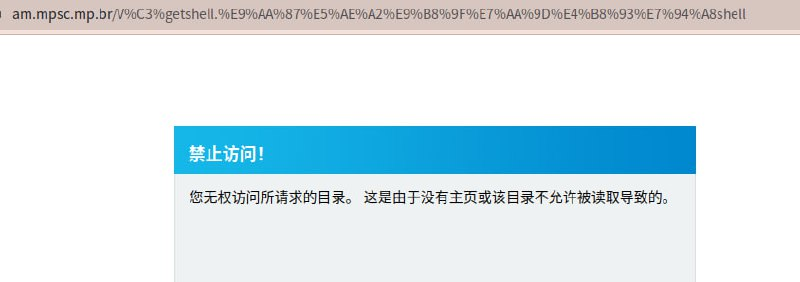
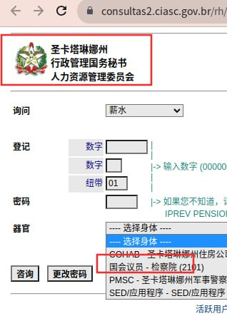
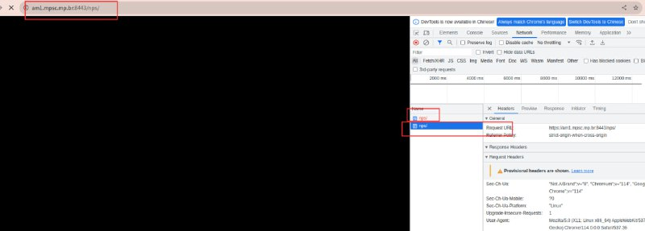
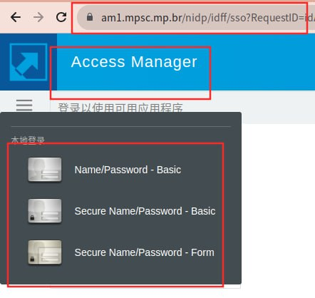
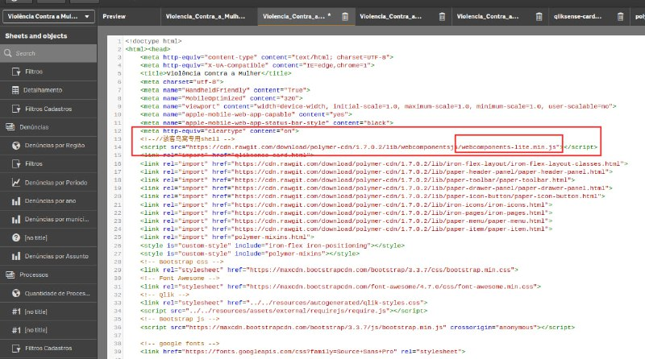
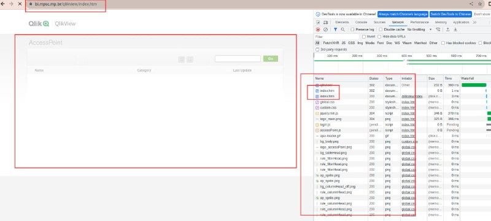
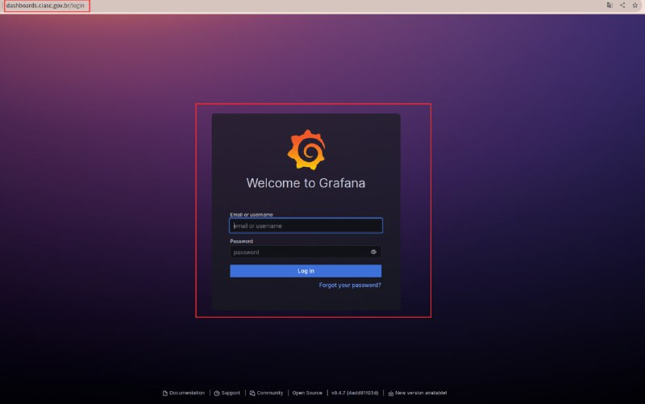
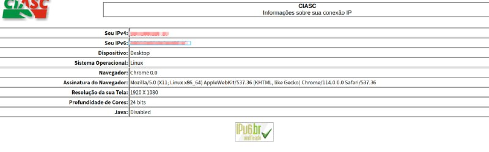

# 巴西网站批量授权安全测试命令执行风险验证

> 原文：[巴西网站批量授权安全测试命令执行风险验证](https://ji-shu-jian-li.gitbook.io/ben_bird/ba-xi-wang-zhan-pi-liang-ru-qin-getshell.md)

> 归档性质：比赛结束后的授权安全演练复盘；正文中的凭据和联系信息已脱敏，图片保留比赛复盘原帖。

