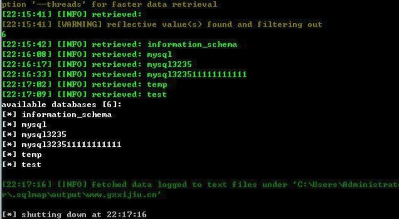
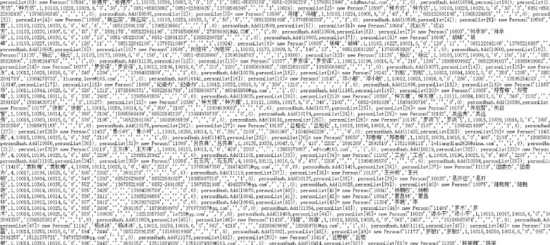
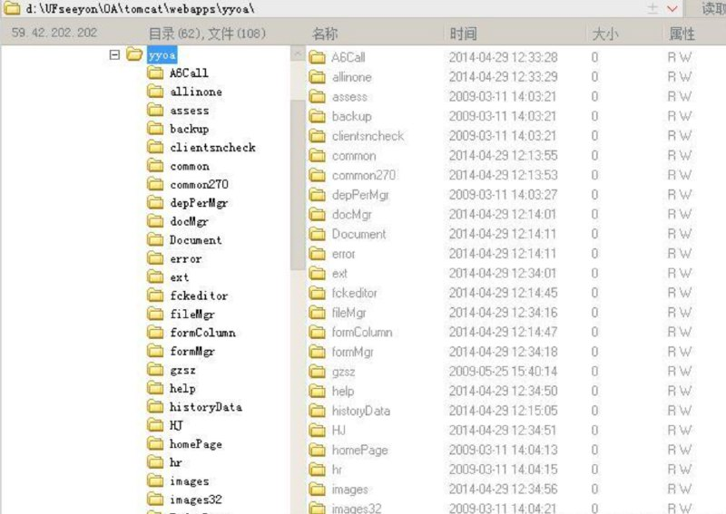

# 某企业（sql+越权）全部员工等信息泄漏DBA权限已命令执行风险验证 授权安全测试 root

> 原文：[某企业（sql+越权）全部员工等信息泄漏DBA权限已命令执行风险验证 授权安全测试 root](https://ji-shu-jian-li.gitbook.io/ben_bird/gui-zhou-mao-tai-sql+-yue-quan-quan-bu-yuan-gong-deng-xin-xi-xie-lou-dba-quan-xian-yi-getshell-na-xi.md)

> 归档性质：比赛结束后的授权安全演练复盘；正文中的凭据和联系信息已脱敏，图片保留比赛复盘原帖。

