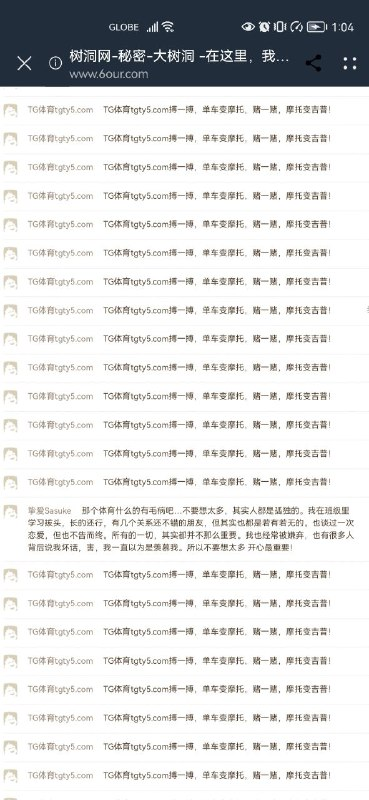
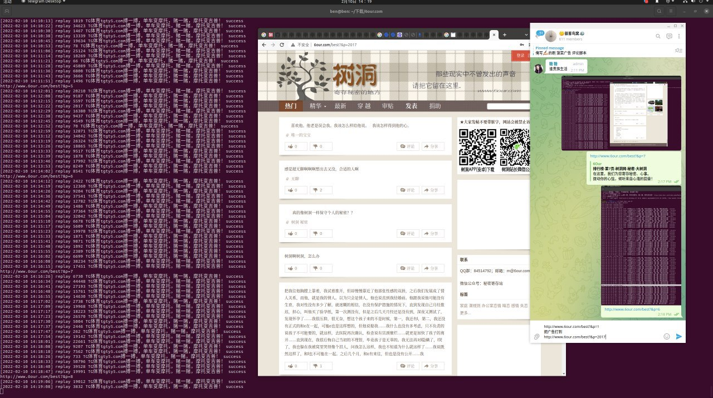
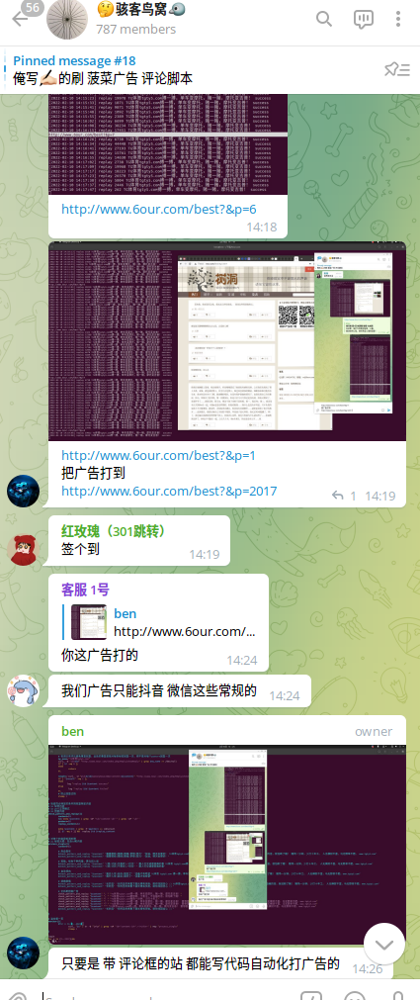
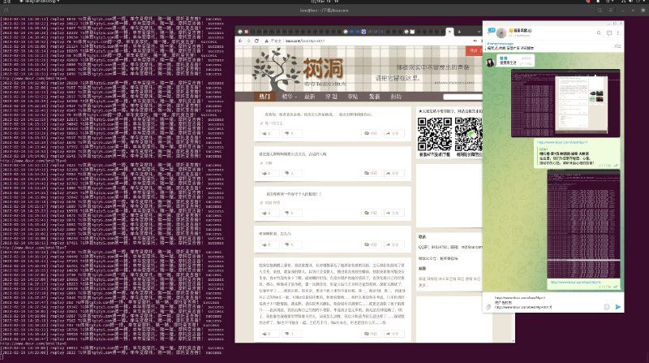
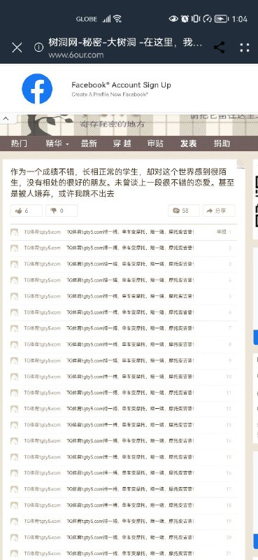

# 目标示例 评论风控测试

> 原文：[目标示例 评论风控测试](https://ji-shu-jian-li.gitbook.io/ben_bird/6our.com-shua-ping-lun-guang-gao.md)

> 归档性质：比赛结束后的授权安全演练复盘；正文中的凭据和联系信息已脱敏，图片保留比赛复盘原帖。

## 目标示例 评论风控测试















```bash
#cat 目标示例.sh
#! /bin/bash
for username in "u1" "u2" "u3" "u4" "u5";do
    敏感凭据：[已脱敏] ad="TG体育www.tgty5.com"
    curl_Chrome(){
        curl -s --user-agent "Mozilla/5.0 (Windows NT 10.0; WOW64) AppleWebKit/537.36 (KHTML, like Gecko) Chrome/64.0.3282.119 Safari/537.36"  -b $username -c $username $@
    } #模拟chrome客户端
    hash_param=`curl_Chrome "示例地址 | grep -oE "[0-9a-z]+\_[0-9a-z]+" | tail -n 1` #获取浏览器分配的 hash
    curl_Chrome -d "account=${username}&敏感凭据：[已脱敏] "示例地址 | grep "登录成功" #进行 账户 密码 哈希 登陆
    for n in {1..2023};do #热门有 2023 页 示例地址
        for i in `curl_Chrome "示例地址 | tr -d "\r\n" | grep -oP 'id="content-\d+".+?</div>' | awk '{print $0}'`;do #获取每页的评论
            id=`echo $i | grep -oP 'id="content-\d+"' | grep -oP '\d+'` result=`curl_Chrome -d "pid=${id}&anonymous=0&arcontent=${ad}" "示例地址 #根据每页评论id回复广告
            if [ "$result" -eq 1 ];then echo "`date +'%F %T'` 示例地址 $id $ad success" ; else echo "`date +'%F %T'` 示例地址 $id $ad failed" ; fi #判断广告回复是否成功
        done #一页一页回复广告结束
    done >> $username.log & #热门 2023 页 示例地址 广告回复结束
done
```
