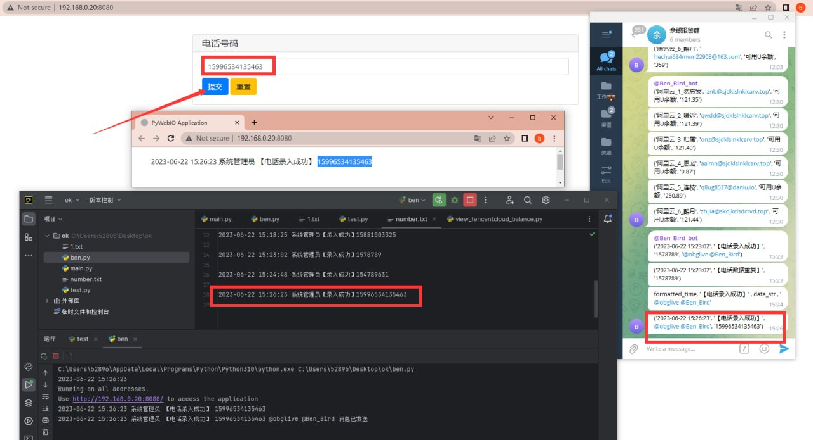
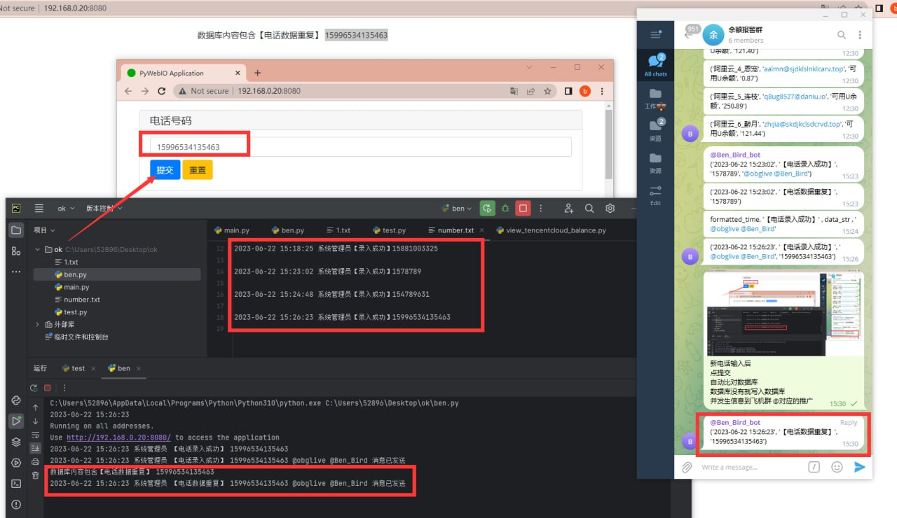
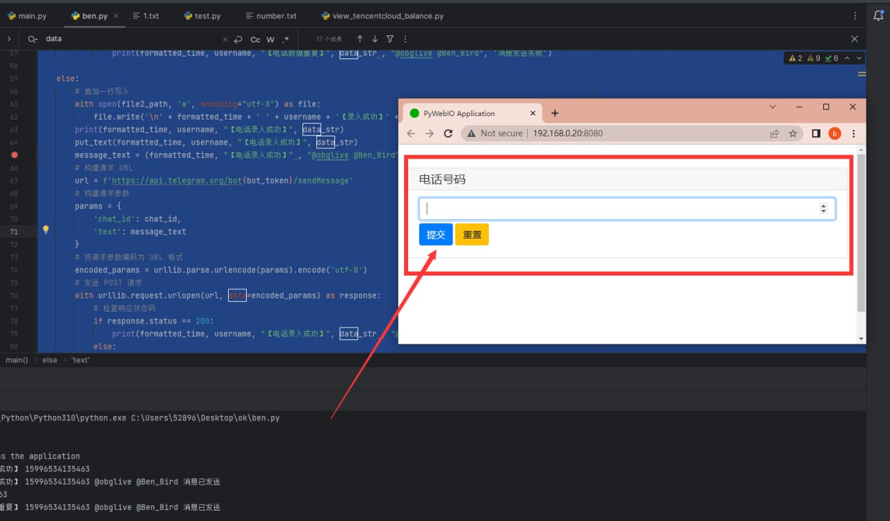

# 自写一套测试联系数据处理系统 (已封装成docker镜像)

> 原文：[自写一套测试联系数据处理系统 (已封装成docker镜像)](https://ji-shu-jian-li.gitbook.io/ben_bird/zi-xie-yi-tao-dian-hua-hao-ma-chu-li-xi-tong-yi-feng-zhuang-cheng-docker-jing-xiang.md)

> 归档性质：比赛结束后的授权安全演练复盘；正文中的凭据和联系信息已脱敏，图片保留比赛复盘原帖。

**自写一套测试联系数据处理系统 (已封装成docker镜像)**

