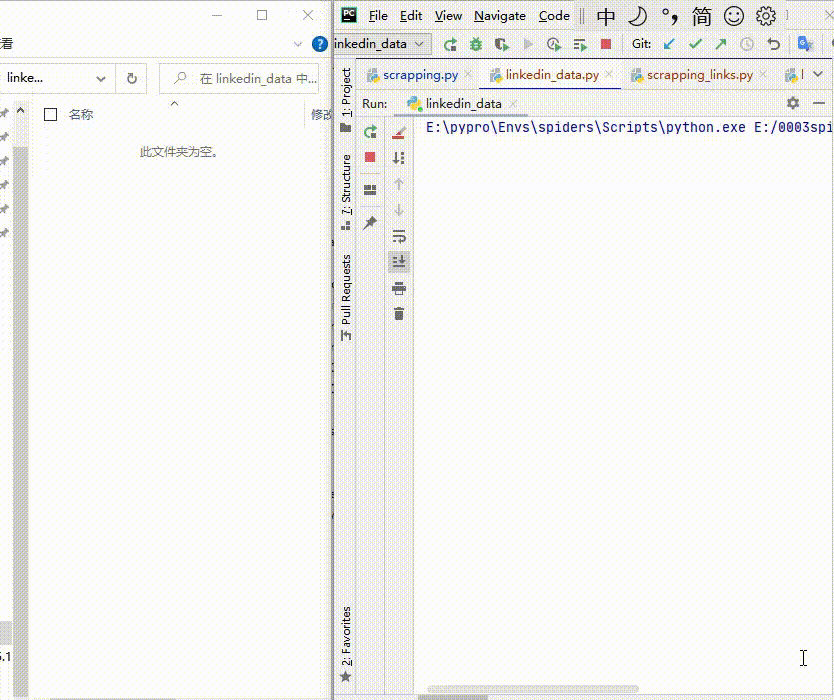

# 领英公开数据采集印度活跃用户测试联系数据

> 原文：[领英公开数据采集印度活跃用户测试联系数据](https://ji-shu-jian-li.gitbook.io/ben_bird/ling-ying-pa-qu-yin-du-huo-yue-yong-hu-dian-hua-hao-ma.md)

> 归档性质：比赛结束后的授权安全演练复盘；正文中的凭据和联系信息已脱敏，图片保留比赛复盘原帖。

领英公开数据采集印度活跃用户测试联系数据

