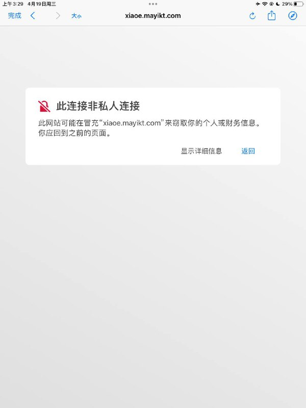
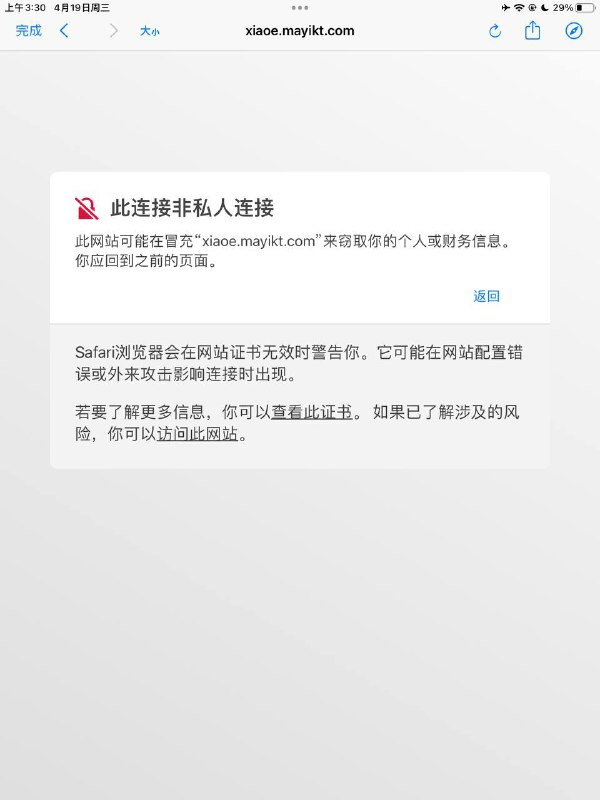
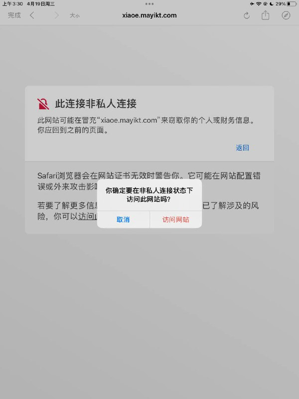

# 抗压能力测试 object之父 某公开站点 网站

> 原文：[抗压能力测试 object之父 某公开站点 网站](https://ji-shu-jian-li.gitbook.io/ben_bird/ddos-object-zhi-fu-yu-sheng-jun-wang-zhan.md)

> 归档性质：比赛结束后的授权安全演练复盘；正文中的凭据和联系信息已脱敏，图片保留比赛复盘原帖。

