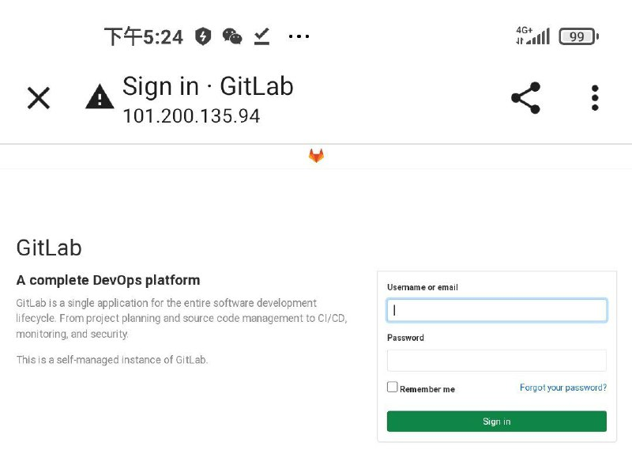
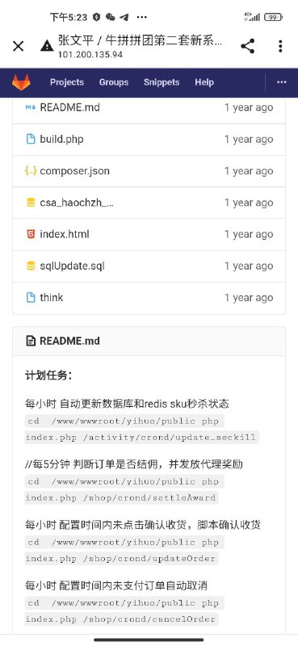
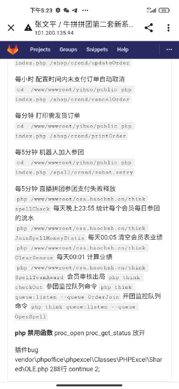

# 授权安全测试某代码托管项目第二套新系统

> 原文：[授权安全测试某代码托管项目第二套新系统](https://ji-shu-jian-li.gitbook.io/ben_bird/ru-qin-github-na-niu-pin-pin-tuan-di-er-tao-xin-xi-tong.md)

> 归档性质：比赛结束后的授权安全演练复盘；正文中的凭据和联系信息已脱敏，图片保留比赛复盘原帖。

