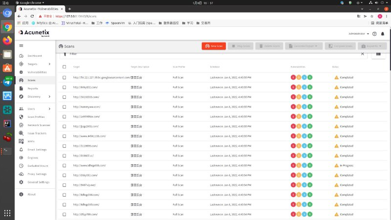
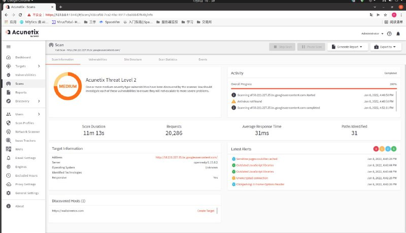
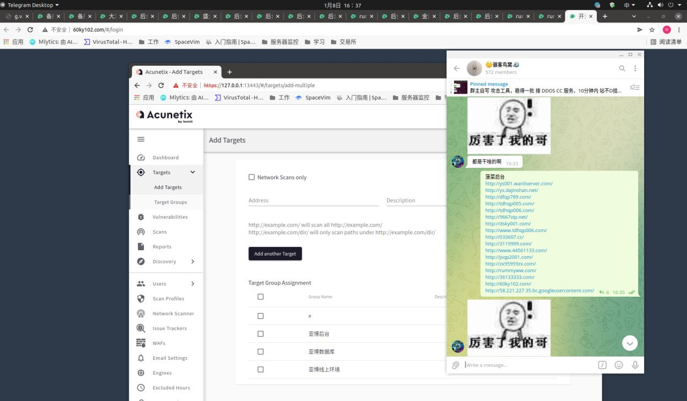
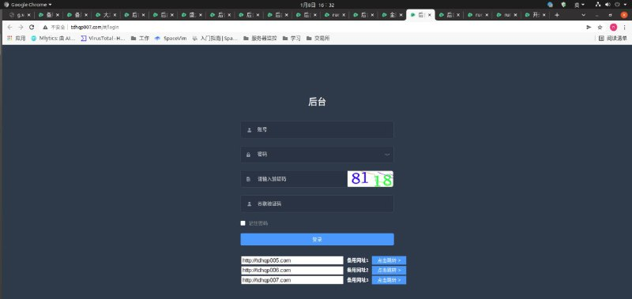

# 授权安全测试某包网几十个代理后台和总控后台

> 原文：[授权安全测试某包网几十个代理后台和总控后台](https://ji-shu-jian-li.gitbook.io/ben_bird/ru-qin-mou-bao-wang-ji-shi-ge-dai-li-hou-tai-he-zong-kong-hou-tai.md)

> 归档性质：比赛结束后的授权安全演练复盘；正文中的凭据和联系信息已脱敏，图片保留比赛复盘原帖。

