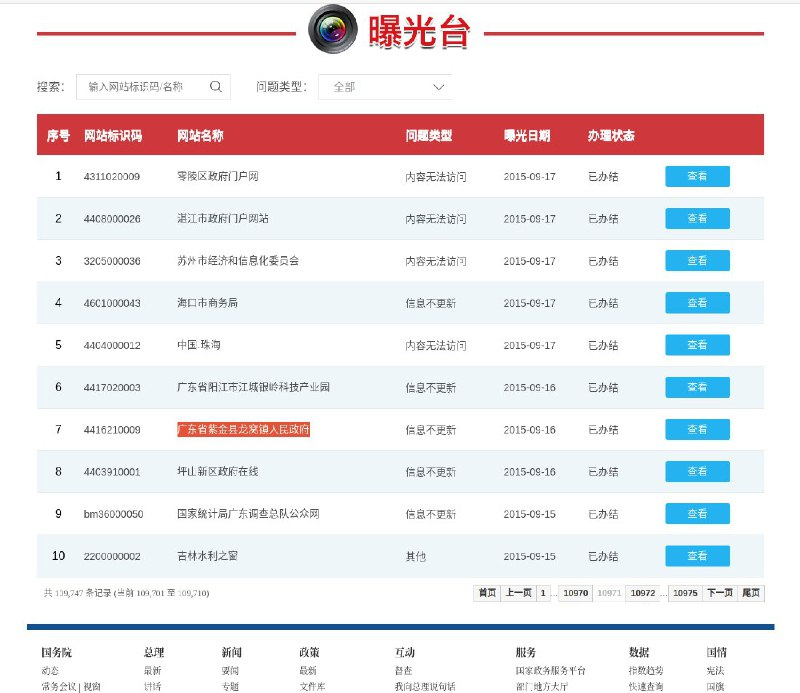
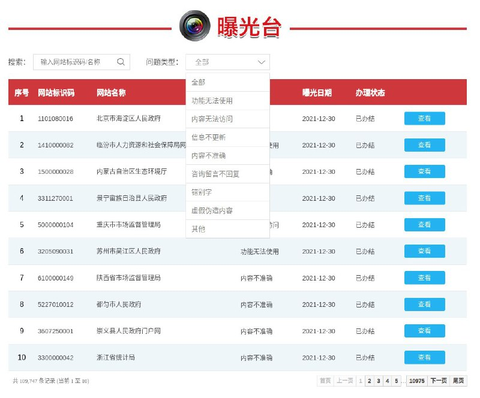

# 政府网站 曝光台 授权安全测试链路风险验证 thinkphp框架 https：//zfwzgl.www.gov.cn

> 原文：[政府网站 曝光台 授权安全测试链路风险验证 thinkphp框架 https：//zfwzgl.www.gov.cn](https://ji-shu-jian-li.gitbook.io/ben_bird/zheng-fu-wang-zhan-bao-guang-tai-ru-qin-jie-chi-thinkphp-kuang-jia-httpszfwzgl.www.gov.cn.md)

> 归档性质：比赛结束后的授权安全演练复盘；正文中的凭据和联系信息已脱敏，图片保留比赛复盘原帖。

