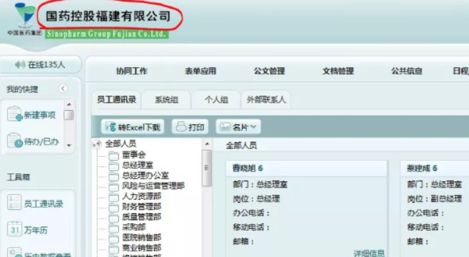

# 某福建网站session链路风险验证登陆授权安全测试成功

> 原文：[某福建网站session链路风险验证登陆授权安全测试成功](https://ji-shu-jian-li.gitbook.io/ben_bird/mou-fu-jian-wang-zhan-session-jie-chi-deng-lu-gong-ji-cheng-gong.md)

> 归档性质：比赛结束后的授权安全演练复盘；正文中的凭据和联系信息已脱敏，图片保留比赛复盘原帖。

