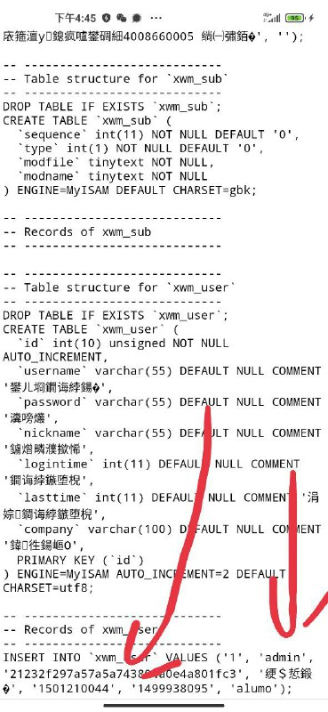
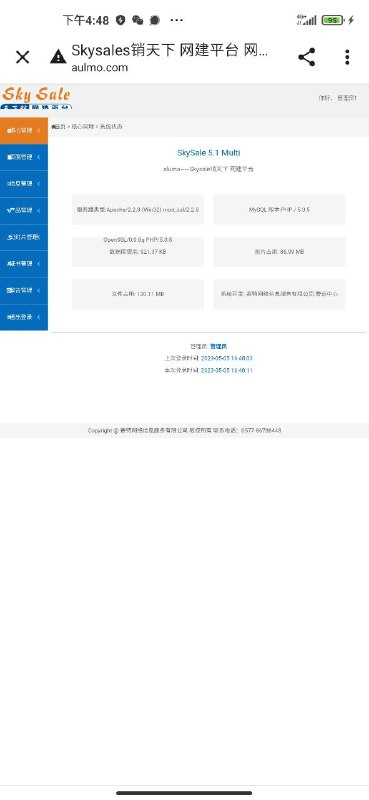
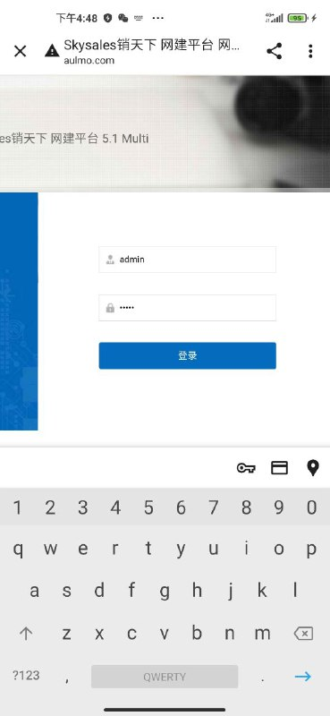
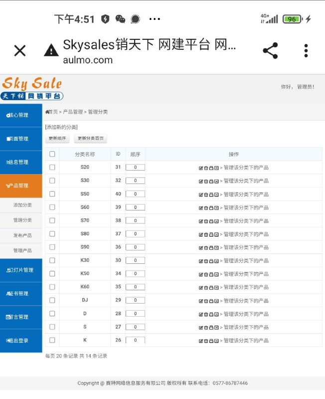

# 目标示例 通过备份sql实现授权安全测试

> 原文：[目标示例 通过备份sql实现授权安全测试](https://ji-shu-jian-li.gitbook.io/ben_bird/aulmo.com-tong-guo-bei-fen-sql-shi-xian-ru-qin.md)

> 归档性质：比赛结束后的授权安全演练复盘；正文中的凭据和联系信息已脱敏，图片保留比赛复盘原帖。

