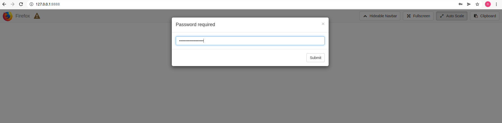

# 盘口项目后台安全登陆防黑客实现

> 原文：[盘口项目后台安全登陆防黑客实现](https://ji-shu-jian-li.gitbook.io/ben_bird/pan-kou-xiang-mu-hou-tai-an-quan-deng-lu-fang-hei-ke-shi-xian.md)

> 归档性质：比赛结束后的授权安全演练复盘；正文中的凭据和联系信息已脱敏，图片保留比赛复盘原帖。

#### 盘口项目后台安全登陆防黑客实现 

[示例地址)
