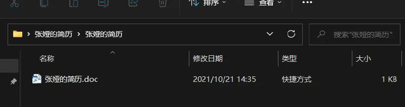

# 解压后看不到文件的恶意样本分析|不显示文件的恶意样本分析

> 原文：[解压后看不到文件的恶意样本分析|不显示文件的恶意样本分析](https://ji-shu-jian-li.gitbook.io/ben_bird/jie-ya-hou-kan-bu-dao-wen-jian-de-diao-yu-gong-ju-bao-bu-xian-shi-wen-jian-de-bing-du.md)

> 归档性质：比赛结束后的授权安全演练复盘；正文中的凭据和联系信息已脱敏，图片保留比赛复盘原帖。

