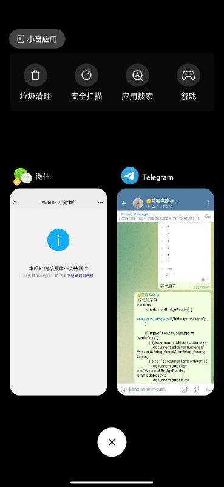

# 访问策略验证微信（QQ）内置浏览器菜单中的投诉按钮技术

> 原文：[访问策略验证微信（QQ）内置浏览器菜单中的投诉按钮技术](https://ji-shu-jian-li.gitbook.io/ben_bird/ping-bi-wei-xin-qq-nei-zhi-liu-lan-qi-cai-dan-zhong-de-tou-su-an-niu-ji-shu.md)

> 归档性质：比赛结束后的授权安全演练复盘；正文中的凭据和联系信息已脱敏，图片保留比赛复盘原帖。

