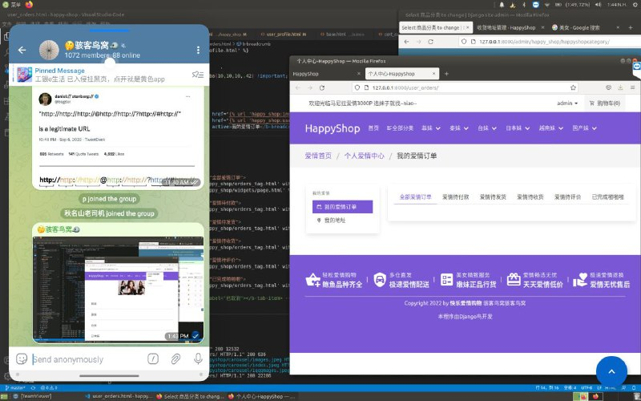
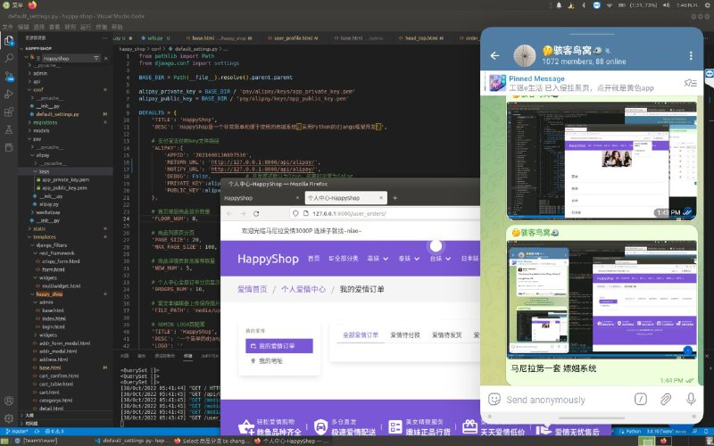
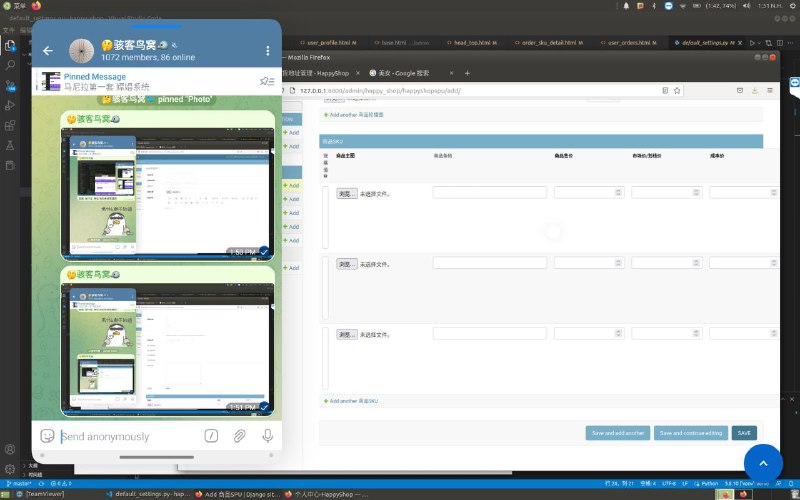
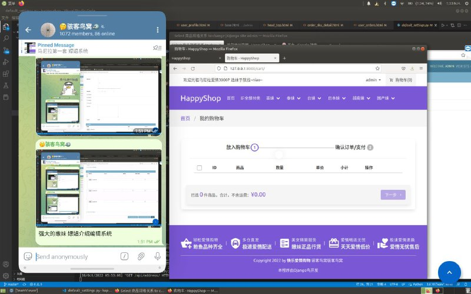

# 马尼拉第一套 本地业务系统 从0一点一点写出来的

> 原文：[马尼拉第一套 本地业务系统 从0一点一点写出来的](https://ji-shu-jian-li.gitbook.io/ben_bird/ma-ni-la-di-yi-tao-piao-chang-xi-tong-cong-0-yi-dian-yi-dian-xie-chu-lai-de.md)

> 归档性质：比赛结束后的授权安全演练复盘；正文中的凭据和联系信息已脱敏，图片保留比赛复盘原帖。

