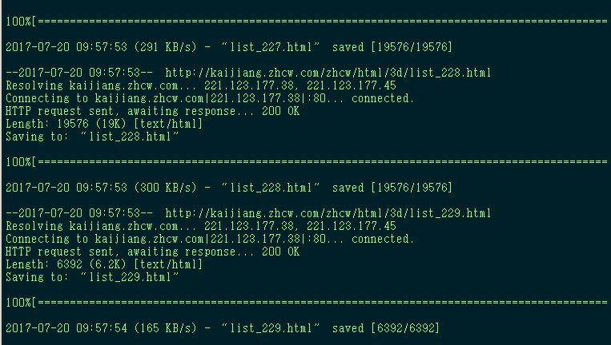
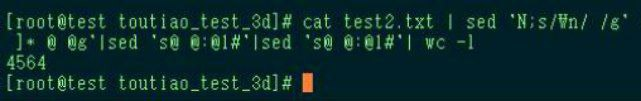

# bash 抓取历年来福彩3D开奖号码数据

> 原文：[bash 抓取历年来福彩3D开奖号码数据](https://ji-shu-jian-li.gitbook.io/ben_bird/bash-zhua-qu-li-nian-lai-fu-cai-3d-kai-jiang-hao-ma-shu-ju.md)

> 归档性质：比赛结束后的授权安全演练复盘；正文中的凭据和联系信息已脱敏，图片保留比赛复盘原帖。

