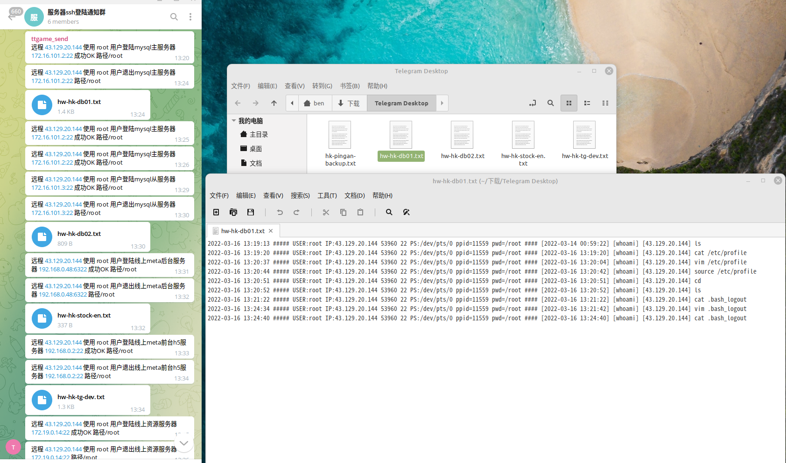

# ssh 登录/登出监控和操作记录实现

> 原文：[ssh 登录/登出监控和操作记录实现](https://ji-shu-jian-li.gitbook.io/ben_bird/ssh-deng-lu-deng-chu-jian-kong-he-cao-zuo-ji-lu-shi-xian.md)

> 归档性质：比赛结束后的授权安全演练复盘；敏感目标、凭据和截图已脱敏。

#### ssh 登录/登出监控和操作记录实现 <a href="#ssh-deng-lu-deng-chu-jian-kong-he-cao-zuo-ji-lu-shi-xian" id="ssh-deng-lu-deng-chu-jian-kong-he-cao-zuo-ji-lu-shi-xian"></a>



[原始媒体链接已归档]

```bash
#!/bin/sh
# Telegram接收SSH登陆提醒
#编辑 /etc/ssh/sshrc 放入以下代码
IP="$(echo $SSH_CONNECTION | cut -d " " -f 1)"
HOSTNAME=$(hostname)
NOW=$(date +"%e %b %Y, %a %r")

CONTENT="$IP 登录到主机 $HOSTNAME 时间 $NOW."

RES=$(curl -X POST \
  -F "chat_id=-[测试号码已脱敏]" \
  -F "text=${CONTENT}" \
  -o /dev/null --silent \
  -w %{http_code} \
  "示例地址)
#每次登陆 SSH 后 Telegram Bot 都会发送一条通知给你
#注意
#创建了 ~/.ssh/rc 的用户在登陆时只执行该文件，/etc/ssh/sshrc 会被忽略。
#ssh登录端口转发时会触发，但是开启 -N 选项后不会触发。
#当然这也并不是就万无一失了。提高安全意识，按时更换密码和私钥，不使用来历不明的代码才是正确的姿势。
#最后当然是祈祷这个脚本一次也不要派上用场。（别被黑客日了）
```

```bash
#!/bin/sh
# Telegram接收SSH退出提醒
#编辑 /root/.bash_logout 放入以下代码
IP="$(echo $SSH_CONNECTION | cut -d " " -f 1)"
HOSTNAME=$(hostname)
NOW=$(date +"%e %b %Y, %a %r")

CONTENT="$IP 登出exit主机 $HOSTNAME 时间 $NOW."

RES=$(curl -X POST \
  -F "chat_id=-[测试号码已脱敏]" \
  -F "text=${CONTENT}" \
  -o /dev/null --silent \
  -w %{http_code} \
  "示例地址)
#每次退出 SSH 后 Telegram Bot 都会发送一条通知给你
cat /var/log/check_user_history.log | grep $(date "+%Y-%m-%d") > /var/log/$HOSTNAME.txt
curl -s "示例地址 \
-F document=@"/var/log/$HOSTNAME.txt"
#每次退出 SSH 后 Telegram Bot 都会发送操作记录到群
```
