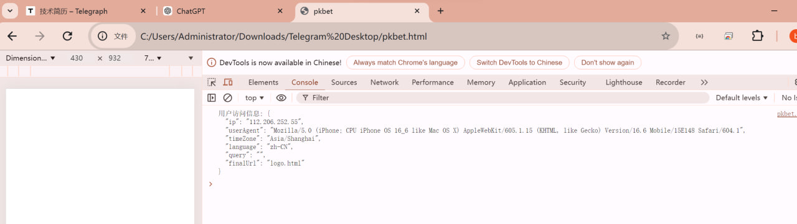

# 移动应用合规上架代码编写

> 原文：[移动应用合规上架代码编写](https://ji-shu-jian-li.gitbook.io/ben_bird/ping-guo-shang-dian-shen-he-guo-bai-dai-ma-bian-xie.md)

> 归档性质：比赛结束后的授权安全演练复盘；正文中的凭据和联系信息已脱敏，图片保留比赛复盘原帖。



判断用户 是 越南时间 就 跳转到 BC 页面否则白色页面

判断用户 是 越南语言 就 跳转到 BC 页面否则白色页面

```html
<!DOCTYPE html>
<html>

<head>
    <title>pkbet</title>
    <meta http-equiv="Cache-Control" content="no-cache, no-store, must-revalidate">
    <meta http-equiv="Pragma" content="no-cache">
    <meta http-equiv="Expires" content="0">
    <meta http-equiv="Cache" content="no-cache">
</head>

<body>

    <script>
        /**
         * 判断是否为苹果客户端
         * @returns {boolean} 如果是苹果客户端则返回 true，否则返回 false
         */
        function isAppleDevice() {
            // 获取用户代理字符串
            const userAgent = navigator.userAgent || navigator.vendor || window.opera;
            // 判断是否包含 iPhone、iPad 或 iPod 字符串
            return /iPad|iPhone|iPod/.test(userAgent) && !window.MSStream;
        }

        /**
         * 记录用户信息并打印到控制台
         * @param {string} finalUrl - 用户最终访问的地址
         */
        function logUserInfo(finalUrl) {
            // 获取用户的 IP 地址 (通常需要后端提供)
            fetch('示例地址)
                .then(response => response.json())
                .then(data => {
                    const userIp = data.ip;

                    // 获取用户代理字符串
                    const userAgent = navigator.userAgent || navigator.vendor || window.opera;
                    // 获取用户的时区
                    const userTimeZone = Intl.DateTimeFormat().resolvedOptions().timeZone;
                    // 获取用户的语言设置
                    const userLanguage = navigator.language || navigator.userLanguage;
                    // 获取 query 参数
                    const query = window.location.search.substring(1);

                    // 创建日志对象
                    const logData = {
                        ip: userIp,
                        userAgent: userAgent,
                        timeZone: userTimeZone,
                        language: userLanguage,
                        query: query,
                        finalUrl: finalUrl
                    };

                    // 在浏览器控制台中输出日志，便于调试
                    console.log("用户访问信息:", JSON.stringify(logData, null, 2));

                    // 将用户信息保存到 localStorage
                    localStorage.setItem('userLog', JSON.stringify(logData));
                });
        }

        /**
         * 根据用户语言和时区决定打开的页面
         * 接受从官网登录带过来的登录信息 query
         */
        function redirectToPageBasedOnLanguageAndTimeZone() {
            // 获取用户的时区
            const userTimeZone = Intl.DateTimeFormat().resolvedOptions().timeZone;
            // 获取用户的语言设置
            const userLanguage = navigator.language || navigator.userLanguage;

            // 判断是否为越南时区
            const isVietnamTimeZone = userTimeZone === 'Asia/Ho_Chi_Minh';
            // 判断是否为越南语言
            const isVietnamLanguage = userLanguage === 'vi-VN';

            // 定义 H5 版本
            const h5version = "pk0912";

            // 获取 query 参数，保存登录信息
            var query = window.location.search.substring(1);

            // 最终访问地址的变量
            let finalUrl;

            // 如果是苹果设备
            if (isAppleDevice()) {
                // 如果是越南时区或越南语言，打开越南特定页面
                if (isVietnamTimeZone || isVietnamLanguage) {
                    finalUrl = query === '' || query === null
                        ? "示例地址 + h5version + "/index.html"
                        : "示例地址 + h5version + "/index.html?" + query;
                } else {
                    finalUrl = 'logo.html';
                }
            } else {
                // 如果不是苹果设备，直接打开主页面
                finalUrl = query === '' || query === null
                    ? "示例地址 + h5version + "/index.html"
                    : "示例地址 + h5version + "/index.html?" + query;
            }

            // 记录用户信息并保存到 localStorage，然后跳转
            logUserInfo(finalUrl);

            // 延迟跳转，以确保日志保存完成
            setTimeout(() => {
                window.location.href = finalUrl;
            }, 1000); // 1秒钟延迟
        }

        // 页面加载完成后执行函数
        document.addEventListener('DOMContentLoaded', redirectToPageBasedOnLanguageAndTimeZone);
    </script>

</body>

</html>

```
