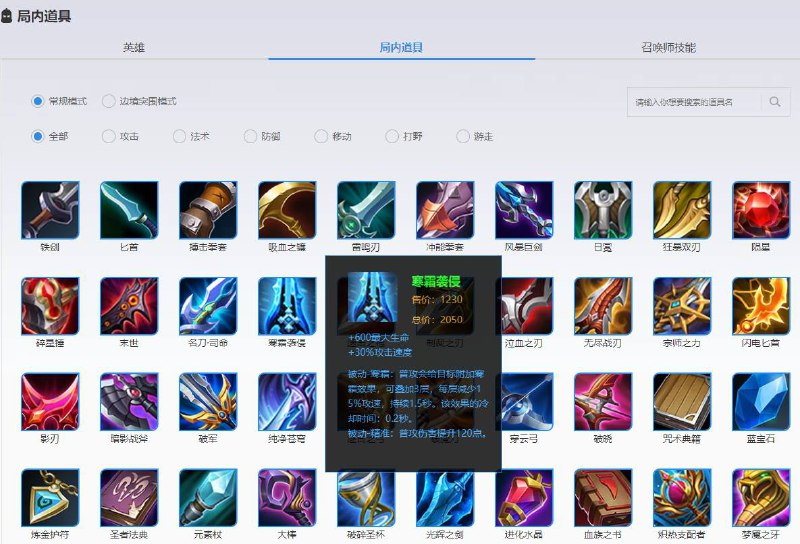
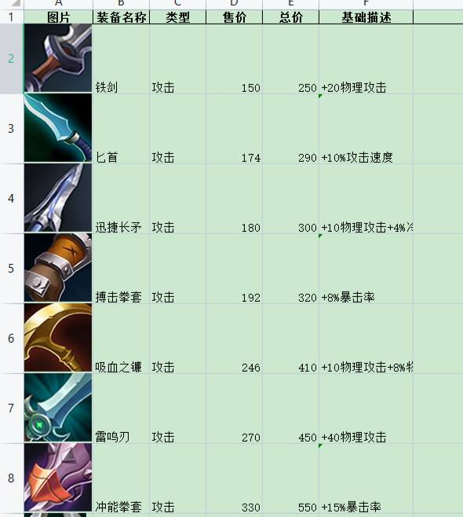
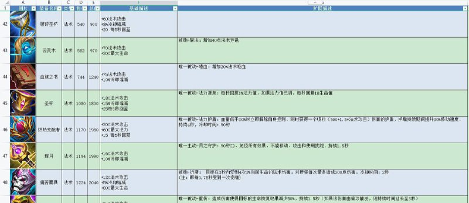

# Python 生成王者荣耀装备信息Markdown和Excel

> 原文：[Python 生成王者荣耀装备信息Markdown和Excel](https://ji-shu-jian-li.gitbook.io/ben_bird/python-sheng-cheng-wang-zhe-rong-yao-zhuang-bei-xin-xi-markdown-he-excel.md)

> 归档性质：比赛结束后的授权安全演练复盘；正文中的凭据和联系信息已脱敏，图片保留比赛复盘原帖。

