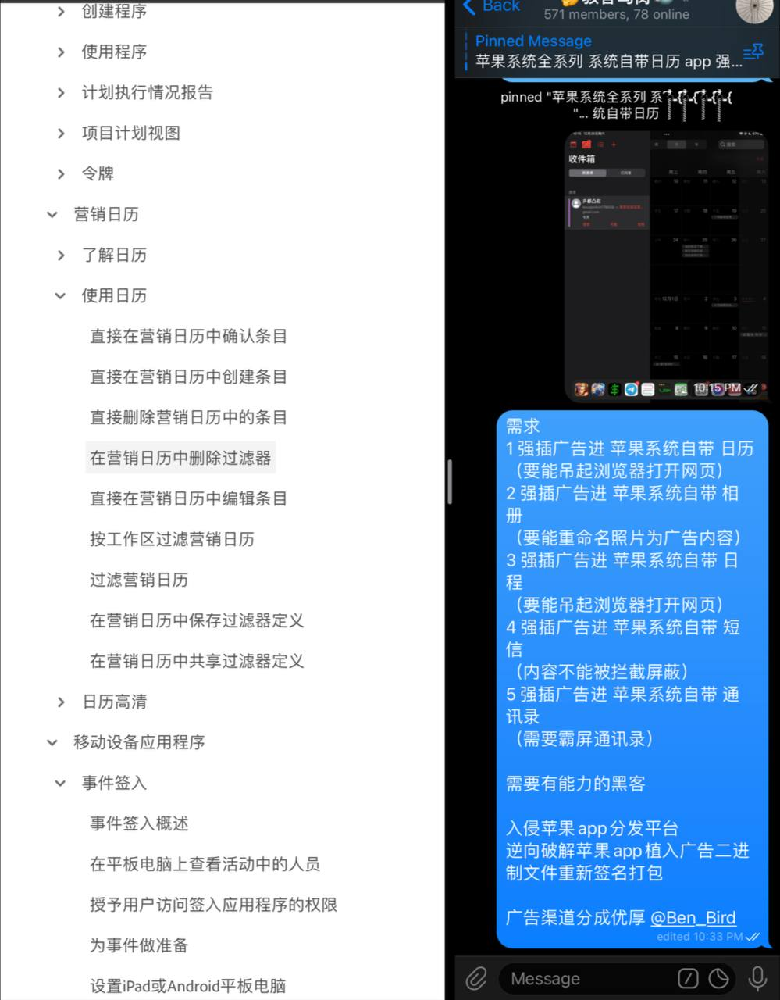
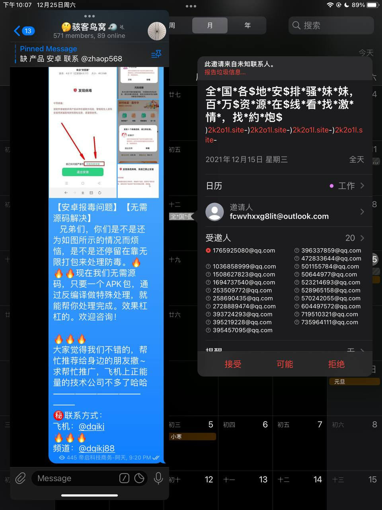
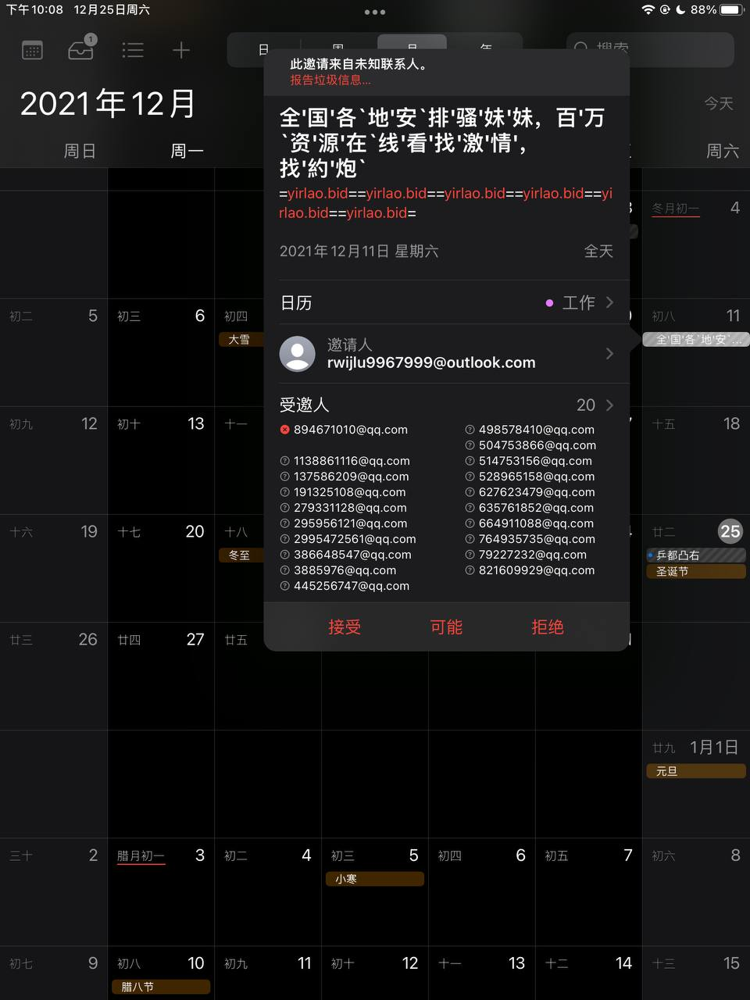
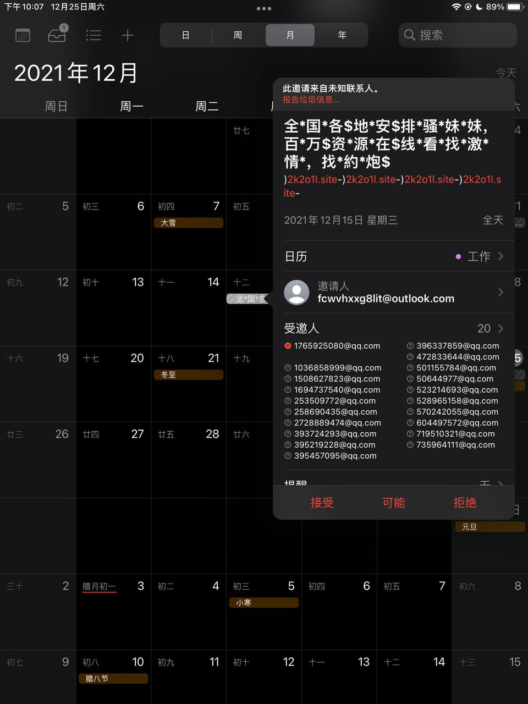
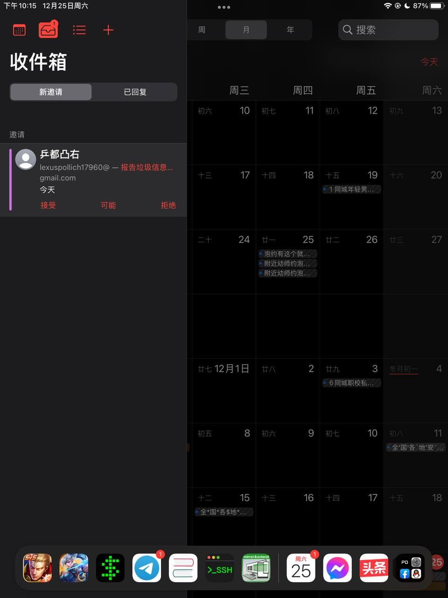

# 苹果系统全系列 系统自带日历 app 强制插广告软件编写制作

> 原文：[苹果系统全系列 系统自带日历 app 强制插广告软件编写制作](https://ji-shu-jian-li.gitbook.io/ben_bird/ping-guo-xi-tong-quan-xi-lie-xi-tong-zi-dai-ri-li-app-qiang-zhi-cha-guang-gao-ruan-jian-bian-xie-zhi.md)

> 归档性质：比赛结束后的授权安全演练复盘；正文中的凭据和联系信息已脱敏，图片保留比赛复盘原帖。

