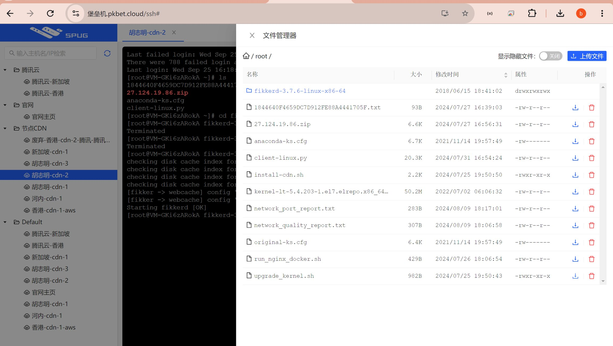
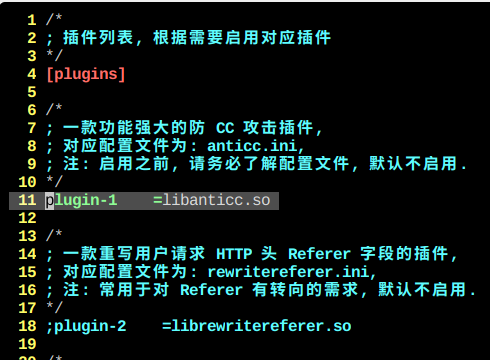
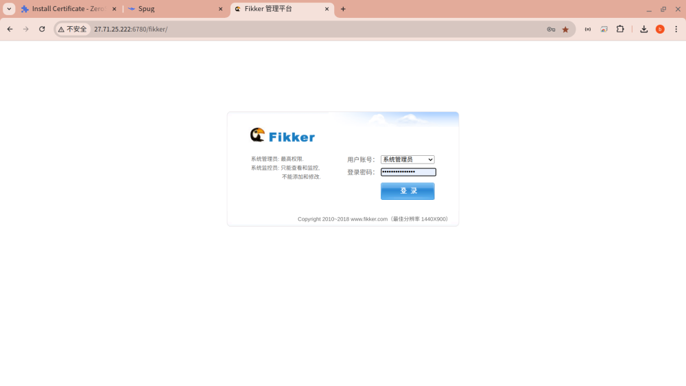
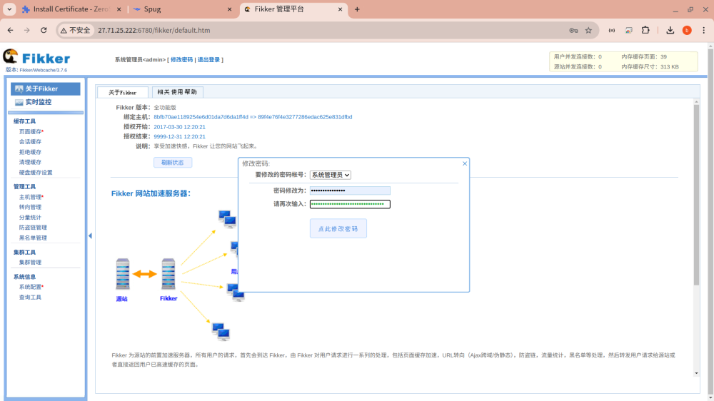
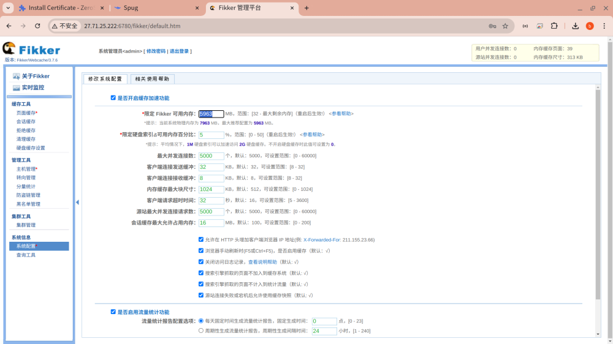
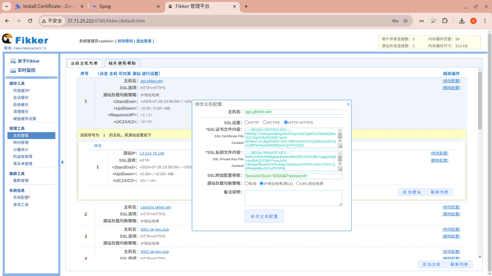
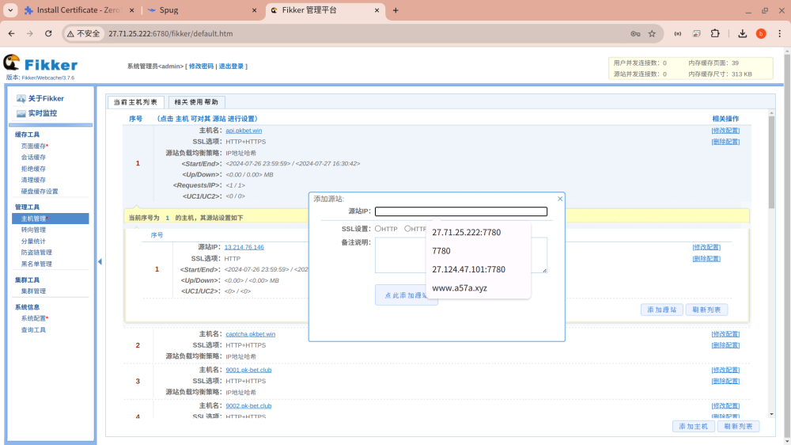
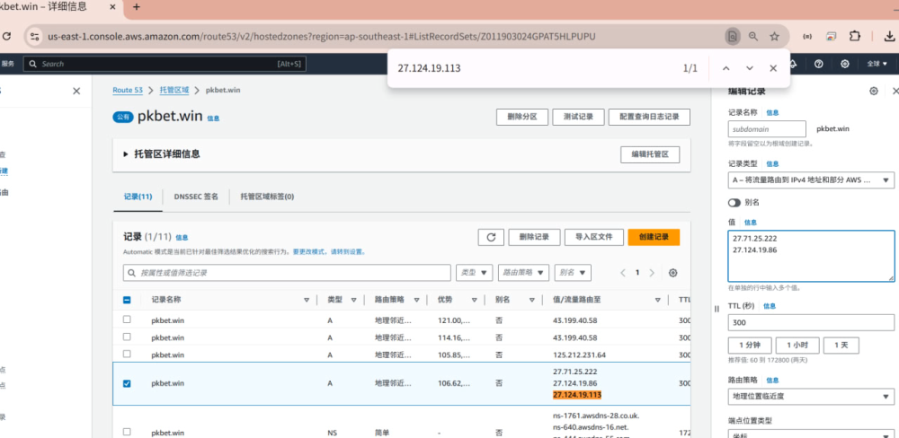

# 自建越南/巴西cdn服务器节点

> GitHub 仓库源文件：[点击打开网页渲染版](https://github.com/ben2023niao/ben-ops-notes/blob/main/doc/md/202409252009-%E5%AE%89%E5%85%A8%E7%AB%9E%E8%B5%9B%E5%A4%8D%E7%9B%98%2BLinux%2BCDN-%E8%87%AA%E5%BB%BA%E8%B6%8A%E5%8D%97-%E5%B7%B4%E8%A5%BFcdn%E6%9C%8D%E5%8A%A1%E5%99%A8%E8%8A%82%E7%82%B9.md)

> 原文：[自建越南/巴西cdn服务器节点](https://ji-shu-jian-li.gitbook.io/ben_bird/zi-jian-yue-nan-ba-xi-cdn-fu-wu-qi-jie-dian.html)

> 来源：GitBook 网页 HTML｜页面时间：2024-09-25 20:09｜日期依据：GitBook 页面更新时间

1 先运行这个脚本升级服务器内核

[upgrade_kernel.sh](https://223452648-files.gitbook.io/~/files/v0/b/gitbook-x-prod.appspot.com/o/spaces%2FsSk3NOIHInyaEoVplYCL%2Fuploads%2FrLt8c7O48Q2lb5C9qvys%2Fupgrade_kernel.sh?alt=media&token=[已脱敏]

升级内核脚本

2 运行这个脚本安装CDN节点

[install-cdn.sh](https://223452648-files.gitbook.io/~/files/v0/b/gitbook-x-prod.appspot.com/o/spaces%2FsSk3NOIHInyaEoVplYCL%2Fuploads%2Fp8a6KUzqcLQEDU1rqcv8%2Finstall-cdn.sh?alt=media&token=[已脱敏]

cdn节点安装脚本

3 开启防御

vim /root/fikkerd-3.7.6-linux-x86-64/plugins/plugins.ini

打开11行注释

4 启动cdn节点

cd /root/fikkerd-3.7.6-linux-x86-64/

./fikkerd.sh start

<http://203.0.113.1:6780/fikker/>

默认密码 123456

修改强密码

修改内存

添加域名 证书

添加源站

上 AWS 编写地理经纬度解析

