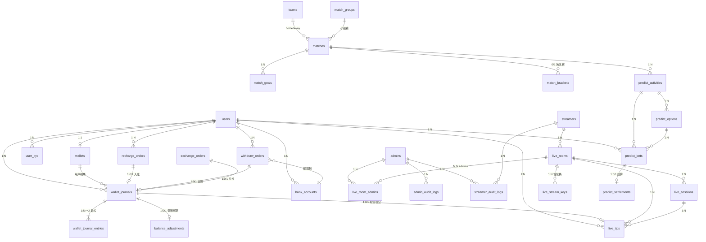

# 数据模型设计 · data-model

> 来源文件：`~/Projects/work/game/xiaolan-watches/dev/docs/architecture/data-model.md`

> 整理日期：2026-05-22 00:00｜日期依据：正文日期

> 对齐 PRD 各模块 §7 数据对象 + `funds-and-ledger.md`
>
> **v0.3（2026-05-22）**：全集 51 张表，本期落地 P0 35 张（迁移脚本 000001-000008）。
> **v0.3.4（2026-05-26）**：补齐风控 MVP 2 张表（`risk_rules` / `risk_alerts`），支撑 ADM-601~ADM-605。
> **v0.3.5（2026-05-30）**：新增运营配置表 `user_level_configs` / `gift_catalog`，承接 ADM-409 / ADM-410；等级只保留累计充值到账钻石升级门槛，不承载特权。
> **v0.3.6（2026-06-02）**：`system_configs` 新增充值规则 seed（手续费、钻石比例、金额上下限、预设金额、精确充值包），承接 WALLET-011 / ADM-914。
> 其余 P1/P2 表（审核/对账/level_log/login_log/user_level_log 等）将在后续迁移补齐。

## 1. 设计原则（强制）

| # | 规则 | 说明 |
|---|---|---|
| 1 | 主键 `BIGINT UNSIGNED` + 雪花 ID（应用生成） | 禁止自增，分布式 + 隐藏行数 |
| 2 | 软删除 `deleted_at DATETIME(3) NULL` | 资金类表禁用软删（订单走状态机） |
| 3 | 时间精度 `DATETIME(3)` 毫秒 | `created_at` / `updated_at` 必有 |
| 4 | 字符集 `utf8mb4_0900_ai_ci` + InnoDB | 全表 emoji 友好 |
| 5 | 钱币类型 | RMB → `DECIMAL(20,2)`；💎 → `BIGINT UNSIGNED` |
| 6 | 状态字段 `TINYINT UNSIGNED` + 注释枚举 | 禁止用字符串 enum |
| 7 | 不建外键约束 | 应用层保证，避免高并发外键锁 |
| 8 | 资金表 CHECK 约束 | MySQL 8.0.16+ 非负校验 |
| 9 | 乐观锁 `version BIGINT UNSIGNED` | 仅 `wallets` 使用 |
| 10 | 软删除参与索引 | 业务索引带 `deleted_at` 列 |
| 11 | 所有迁移 up+down 配对 | `000NNN_topic.{up,down}.sql` |
| 12 | DB 用户权限分离 | 业务账号无 DELETE，DBA 才能 DROP |

## 2. 全集 51 张表清单

| 域 | 表数 | P0 | P1 | P2 | 迁移文件 |
|---|---|---|---|---|---|
| 1 用户认证 | 6 | 4 | 2 | 0 | `000001_create_user_tables` |
| 2 钱包账本 | 8 | 8 | 0 | 0 | `000002_create_wallet_tables` |
| 3 直播 | 8 | 6 | 2 | 0 | `000003_create_live_tables` |
| 4 比赛 | 6 | 5 | 1 | 0 | `000004_create_match_tables` |
| 5 竞猜 | 4 | 4 | 0 | 0 | `000005_create_predict_tables` |
| 6 主播 | 2 | 2 | 0 | 0 | `000006_create_streamer_tables` |
| 7 风控审核 | 6 | 2 | 1 | 3 | `000018_create_risk_tables` |
| 8 对账 | 3 | 0 | 3 | 0 | _(后续 P1)_ |
| 9 系统配置 | 7 | 5 | 2 | 0 | `000007_create_config_tables`, `000024_create_economy_config_tables` |
| 10 审计通用 | 3 | 3 | 0 | 0 | `000008_create_audit_tables` |
| **合计** | **53** | **37** | **13** | **3** | **9 个文件** |

## 3. P0 35 张表索引

### 3.1 域 1 · 用户与认证（4 张）

| 表 | 关键索引 | 用途 |
|---|---|---|
| `users` | uk(account) / uk(user_no) / idx(level,deleted_at) / idx(status,deleted_at) | 登录、客服用户号精确查询、等级筛选、风控冻结筛选 |
| `admins` | uk(username) / idx(role,deleted_at) | 后台登录 + RBAC 检索 |
| `user_kyc` | idx(user_id,status) / idx(id_card_no_hash) | KYC 状态查询、身份证去重 |
| `refresh_token_blacklist` | uk(jti) / idx(expires_at) | 撤销名单查询 + TTL 清理 |

### 3.2 域 2 · 钱包账本（8 张，最严谨）

| 表 | 关键索引 | 用途 |
|---|---|---|
| `wallets` | uk(user_id) + CHECK 非负 | 每用户 1 行，乐观锁 version |
| `wallet_journals` | uk(idempotency_key) / idx(user_id,created_at) / idx(biz_type,biz_id) | 幂等去重 + 用户流水 + 业务反查 |
| `wallet_journal_entries` | idx(journal_id) / idx(account,direction,created_at) | 复式记账分录 |
| `recharge_orders` | uk(order_no) / uk(channel,third_party_no) / idx(user_id,status,created_at) / idx(pay_type,status) | 订单号唯一 + 通道防重 + 用户筛选 + 大白鲨子通道筛选 |
| `withdraw_orders` | uk(order_no) / idx(status,created_at) | 提现队列 |
| `exchange_orders` | uk(order_no) / idx(user_id,created_at) | 兑换流水 |
| `balance_adjustments` | uk(journal_id) / idx(user_id,created_at) | 手工调账审计 |
| `bank_accounts` | uk(user_id,account_no_hash,deleted_at) | 同一用户同一账号去重 |

### 3.3 域 3 · 直播（6 张）

| 表 | 关键索引 | 用途 |
|---|---|---|
| `live_rooms` | uk(room_no) / idx(streamer_id,status,deleted_at) / idx(status,deleted_at) / idx(home_banner_enabled,home_banner_sort,status,deleted_at,home_banner_start_at,home_banner_end_at) | 房间列表、主播房间、首页赛事 Banner 推荐 |
| `live_sessions` | idx(room_id,start_at) / idx(streamer_id,start_at) / idx(status,last_heartbeat_at) | 场次历史；`last_heartbeat_at` 记录主播端业务心跳,用于 60s 失联自动下播兜底；`settlement_tip_rmb` 与 `operator_tip_*` 分开支持主播对账 |
| `live_stream_keys` | uk(stream_key) / idx(room_id,active) | 推流码鉴权 + 历史 |
| `live_room_admins` | uk(active_key) / idx(room_id,admin_id,revoked_at) / idx(admin_id,revoked_at) | 房间管理员多对多关系；`active_key` 为生成列，仅约束未撤销授权唯一 |
| `live_chat_messages_YYYYMM` | idx(room_id,created_at) / idx(user_id,created_at) | **按月分表** |
| `live_tips` | uk(journal_id) / idx(room_id,created_at) / idx(streamer_id,created_at) / idx(session_id,is_operator_tip,settlement_rmb_equiv) | 打赏流水；`rmb_equiv` 为礼物展示价值，`settlement_*` 为主播结算价值 |

### 3.4 域 4 · 比赛（5 张）

| 表 | 关键索引 | 用途 |
|---|---|---|
| `teams` | uk(code) / idx(fifa_rank) | 国家代码唯一 |
| `match_groups` | uk(stage,group_code) | 小组赛分组 |
| `matches` | uk(match_no) / idx(start_at,status) / idx(stage,round) | 时间轴 + 阶段筛选 |
| `match_brackets` | uk(round,position) | 淘汰赛对阵图 |
| `match_goals` | idx(match_id,minute,deleted_at) / idx(team_id,created_at) | 进球事件流 |

### 3.5 域 5 · 竞猜（4 张，核心商业）

| 表 | 关键索引 | 用途 |
|---|---|---|
| `predict_activities` | idx(match_id,status) / idx(status,close_at) / idx(status,settled_at) | 活动列表 + 到期扫描 + 结算队列 |
| `predict_options` | uk(activity_id,option_no) | 活动内选项唯一 |
| `predict_bets` | uk(bet_no) / uk(lock_journal_id) / idx(user_id,status,created_at) / idx(activity_id,option_id) | 押注查询 + 结算扫描 |
| `predict_settlements` | uk(bet_id,batch_no) / uk(journal_id) | 同押注多批次结算（v1/v2） |

### 3.6 域 6 · 主播（2 张）

| 表 | 关键索引 | 用途 |
|---|---|---|
| `streamers` | uk(streamer_no) / idx(status,deleted_at) / idx(total_tip_rmb) | TOP 主播榜 |
| `streamer_audit_logs` | idx(streamer_id,created_at) / idx(operator_created) | 审核轨迹 |

### 3.7 域 9 · 系统配置（3 张）

| 表 | 关键索引 | 用途 |
|---|---|---|
| `system_configs` | uk(config_key) / idx(category) | 通用 K-V；钱包充值规则使用 `wallet.recharge.*` key 动态控制手续费、钻石比例、金额上下限和精确充值包 |
| `level_configs` | PK(level) | 历史等级配置表；新增逻辑不得依赖其中的特权/限额字段 |
| `user_level_configs` | idx(enabled,min_diamond,deleted_at) / idx(level_no,deleted_at) | 用户等级升级门槛，仅按累计充值到账钻石展示进度 |
| `gift_catalog` | idx(enabled,sort_order,deleted_at) / idx(code,deleted_at) | 礼物目录、钻石价格、礼物图标与特效静态图；`effect_type` 仅作旧枚举兼容 |
| `home_banners` | idx(position,enabled,sort_order,deleted_at) | 位置分组排序 |

### 3.8 域 10 · 审计通用（3 张）

| 表 | 关键索引 | 用途 |
|---|---|---|
| `admin_audit_logs` | idx(operator_id,created_at) / idx(target_type,target_id) / idx(action,created_at) | 操作审计三维检索 |
| `idempotency_keys` | uk(scope,key) / idx(expires_at) | 幂等去重 |
| `payment_callbacks` | idx(channel,third_party_no) / idx(order_no) / idx(processed,received_at) | 回调反查 + 重放 |

## 4. ER 关系图



## 5. 复式记账模式

### 5.1 流水写入规范

任何资金变动 = **1 条 `wallet_journals` 主流水** + **≥2 条 `wallet_journal_entries` 分录**

```
示例：用户 #1001 充值 100 元 → 1000💎

INSERT wallet_journals (id=J1, user_id=1001, biz_type='recharge', biz_id=RO1, amount=100.00, currency=1)

INSERT wallet_journal_entries (journal_id=J1, account='user:1001',         direction=1 借, currency=1, amount=100.00)
INSERT wallet_journal_entries (journal_id=J1, account='platform:recharge', direction=2 贷, currency=1, amount=100.00)
```

### 5.2 校验约束

| 校验 | 时机 | 实现 |
|---|---|---|
| 同一 journal 借贷配平 | 事务内 | service 层 + SQL `SELECT SUM(amount * IF(direction=1,1,-1)) GROUP BY journal_id` |
| 单分录金额 > 0 | DDL | `CHECK (amount > 0)` |
| 钱包余额非负 | DDL | `CHECK (rmb_balance >= 0)` 等 |
| 日终全账平衡 | 凌晨 cron | 对账 job：`SUM(entries.amount * sign) GROUP BY currency = 0` |

### 5.3 账户命名

| account | 含义 |
|---|---|
| `user:{user_id}` | 用户账户 |
| `platform:recharge` | 平台收款（充值入账） |
| `platform:withdraw` | 平台付款（提现出账） |
| `platform:exchange_fee` | 兑换手续费收入 |
| `platform:bet_pool` | 押注资金池（押注转入，结算转出） |
| `platform:income` | 平台净收入（打赏分成等） |

## 6. 分表策略

| 表 | 策略 | 触发 | 路由 |
|---|---|---|---|
| `live_chat_messages` | 按月 `live_chat_messages_YYYYMM` | 单月预估 ≥ 1000w 行 | 应用层根据 `created_at` 月份路由；template 表用 `LIKE` 模板克隆 |

其他表 32 天数据量预估均 < 1000w 行，**不分表**，仅做覆盖索引。

## 7. 一致性等级

| 场景 | 等级 | 实现 |
|---|---|---|
| 钱包扣款/入账 | **强一致** | InnoDB 事务 + `SELECT ... FOR UPDATE` + 乐观锁 version |
| 用户余额冗余字段（`users.rmb_balance`） | **最终一致** | 钱包写后异步刷 user 冗余；权威来源是 `wallets` |
| 直播间观众数 | **最终一致** | Redis 计数 + 30s 同步到 DB |
| 比赛比分 | **强一致** | 后台事务写入 |
| 押注流水 | **强一致** | 事务内同时操作 wallets + wallet_journals + predict_bets |
| 弹幕 | **最终一致** | 异步写 DB（先 Redis） |
| 审计日志 | **最终一致** | 异步落库，丢失视为可接受（但需限流告警） |

## 8. 字段编码约定

| 字段 | 规范 |
|---|---|
| 加密字段 | `_enc` 后缀，AES-256-GCM，密钥从环境变量读取 |
| 脱敏字段 | `_mask` 后缀，仅前后 4 位明文 |
| Hash 字段 | `_hash` 后缀，sha256 hex（64 字符），用于精确查询/去重 |
| URL 字段 | `_url` 后缀，VARCHAR(512)，存全路径 |
| 状态字段 | `status` 或 `xxx_status`，TINYINT UNSIGNED，必有 COMMENT |
| 时间字段 | `_at` 后缀，DATETIME(3) |
| 时长字段 | `_duration_sec`，INT/BIGINT UNSIGNED |
| 钱字段（RMB） | `rmb_amount` / `xxx_rmb`，DECIMAL(20,2) |
| 钱字段（💎） | `diamond_amount` / `xxx_diamond`，BIGINT UNSIGNED |

## 9. 已落地的 P1 子集

### 9.1 风控告警 MVP（`000018_create_risk_tables`）

| 表 | 关键索引 | 用途 |
|---|---|---|
| `risk_rules` | uk(rule_code) / idx(enabled,severity,deleted_at) | 风控规则配置、后台启用禁用 |
| `risk_alerts` | uk(rule_code,source_type,source_id) / idx(status,severity,created_at) / idx(target_type,target_id,status) | 告警列表、去重、按用户追踪 |

初始规则：

- `R-301` 单笔大额押注：`threshold_json.min_bet_diamond = 100000`，即 ¥10,000 等值（10 钻石 = ¥1）。

### 9.2 直播间房间级禁言（`000045_create_live_room_bans`）

| 表 | 关键索引 | 用途 |
|---|---|---|
| `live_room_bans` | uk(room_id,user_id) / idx(room_id,expires_at) / idx(user_id,expires_at) / idx(deleted_at) | 后台直播间管控按房间禁言用户；C 端发弹幕前按 room/user/未删除/未过期查询并拦截 |

说明：

- 同一房间同一用户只保留当前禁言配置，重复禁言通过 upsert 延长或覆盖过期时间与原因。
- 操作历史、管理员、失败原因以 `admin_audit_logs` 记录，避免禁言表承担审计流水职责。

## 10. 待办（P1 / P2）

P1 剩余表，下一批迁移：

- `login_logs` `user_level_logs` `live_room_stats_daily` `match_mvps`
- `recon_summaries` `recon_diffs` `recon_history`
- `forbidden_words`
- `feature_flags` `home_ad_slots`

P2 表（3 张）：

- `moderation_reports` `danmaku_violations` `patrol_logs`

## 10. 迁移指令

```bash
# 安装 golang-migrate
brew install golang-migrate

# 创建数据库
mysql -uroot -e "CREATE DATABASE kickoff DEFAULT CHARACTER SET utf8mb4 COLLATE utf8mb4_0900_ai_ci;"

# 跑迁移
cd services/go-app
make migrate-up                    # 跑到最新
make migrate-down                  # 回滚一步
make migrate-new name=add_foo      # 新建迁移文件
make migrate-force v=3             # 修复脏状态
```

## 引用

本文件遵循 [`database-design-standards.md`](database-design-standards.md) 的设计规范。

新表设计使用 [`database-table-template.md`](../templates/database-table-template.md) 模板。

## 表设计索引

| 表 | 模块 | 设计文档 |
|---|---|---|
| users / wallets | 用户与钱包 | `funds-and-ledger.md` |
| wallet_journals / wallet_journal_entries | 复式账本 | `funds-and-ledger.md` |
| recharge_orders / withdraw_orders / withdraw_disbursements | 充值提现 | `funds-and-ledger.md` |
| predict_activities / predict_bets | 竞猜 | `funds-and-ledger.md` |
| live_rooms / live_stream_keys / live_chat_messages_* | 直播 | `system-architecture.md` |
| admin_audit_logs | 审计 | 项目规则 |

## 数据 owner

| 数据域 | owner | 主仓 |
|---|---|---|
| 用户与钱包 | services/go-app | `internal/repository/user/`, `internal/repository/wallet/` |
| 直播间与弹幕 | services/go-app | `internal/repository/live/` |
| 竞猜活动 | services/go-app | `internal/repository/predict/` |
| 主播 | services/go-app | `internal/repository/admin/` |
| 赛事 | services/go-app | `internal/repository/match/` |
| 审计 | services/go-app | `admin_audit_logs` 表 |
| 对象存储 | OSS / S3 + CloudFront | runtime 外 |
