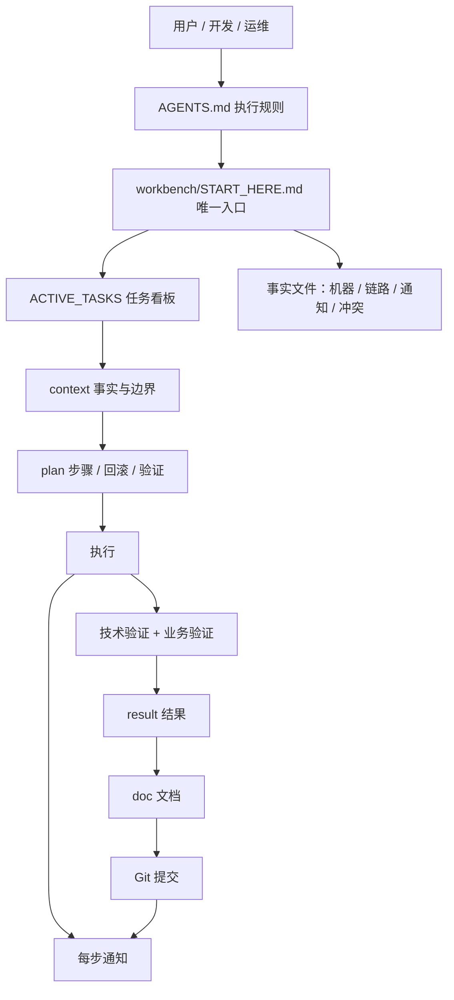

# Workbench 设计思路

> GitHub 仓库源文件：[点击打开网页渲染版](https://github.com/ben2023niao/ben-ops-notes/blob/main/doc/md/202610192033-BKL%20UAT%2BShell%2B%E7%9B%91%E6%8E%A7%E5%91%8A%E8%AD%A6-Workbench%20%E8%AE%BE%E8%AE%A1%E6%80%9D%E8%B7%AF.md)

> 整理日期：2026-10-19 20:33｜日期依据：文件创建/修改时间

## 1. 为什么需要 Workbench

AI 能写代码、能查日志、能执行命令，但它有三个天然短板：

1. **会话记忆不可靠**：换个会话、换台电脑、换个人，上下文就断了。
2. **容易补全不存在的细节**：没有事实约束时，AI 会按经验猜服务器、猜端口、猜流程。
3. **执行速度太快**：一条命令可能改配置、删数据、重启服务，必须有人为的刹车。

传统做法是把这些信息写在聊天记录、个人笔记、脑子里。项目一大，就会出现：

- 同一件事不同人重复做
- 上次改到哪、为什么改，没人说得清
- AI 每次都要重新问一遍背景
- 生产操作没有方案、没有验证、没有回滚
- 密码和 token 散落在文档、脚本、聊天里

Workbench 的目标不是“再写一套文档”，而是给项目建立一份**可执行的状态**：

- 人和 AI 从同一入口读取
- 事实有来源、有置信度
- 任务有上下文、有方案、有结果
- 高风险操作有刹车
- 每次变更都能追溯

## 2. 设计目标

| 目标 | 具体做法 |
| --- | --- |
| 可接手 | 新会话只读 `AGENTS.md` + `workbench/START_HERE.md` 就能继续 |
| 可验证 | 事实分 `VERIFIED` / `USER_CONFIRMED` / `INFERRED` / `UNKNOWN` |
| 可执行 | 每个任务有 context / plan / result |
| 可回滚 | 高风险操作先写备份、回滚、验证方案 |
| 可协作 | 通知、交接、文档、提交都有固定格式 |
| 可移植 | 模板 + 安装器，任何项目一条命令导入 |
| 安全 | 秘密只存环境变量或服务器，不进仓库、不进群 |

## 3. 整体架构



核心文件分四层：

1. **规则层**：`AGENTS.md`，定义 AI 能做什么、不能做什么、按什么顺序做。
2. **事实层**：机器矩阵、运行链路、通知目标、当前状态、冲突记录。
3. **任务层**：`ACTIVE_TASKS.md` + context / plan / result。
4. **证据层**：`doc/` 日期-事项记录、提交历史、通知记录。

## 4. 七个核心原则

### 4.1 状态外置

聊天记录不是数据库。任何需要下次继续的信息，都必须落到文件：

- 服务器地址、账号名、端口
- 域名、证书、反代链路
- 当前任务、阻塞、待确认
- 已验证事实和未知项

### 4.2 单一入口

所有会话都从 `AGENTS.md` 开始，再读 `workbench/START_HERE.md`。
入口固定，AI 不需要猜“先看哪个文件”。

### 4.3 事实分级

| 状态 | 含义 | 写操作前 |
| --- | --- | --- |
| `VERIFIED` | 本轮只读核验过 | 可直接引用 |
| `USER_CONFIRMED` | 用户明确确认 | 可执行低风险操作 |
| `INFERRED` | 推断 | 必须先核验 |
| `UNKNOWN` | 未知 | 禁止猜测 |

事实优先级：

```text
实时只读核验 > 当前 Git/服务器状态 > CURRENT_STATE
> 当前任务 > 历史文档 > 聊天记录
```

### 4.4 任务契约

每个任务必须有三份东西：

- **context**：目标、事实、范围、边界、停止条件
- **plan**：步骤、风险、回滚、验证
- **result**：实际做了什么、改了什么、验证结果、遗留事项

执行层只执行“已批准且上下文一致”的 plan。发现事实冲突，先停下来更新 context。

### 4.5 风险分级

| 等级 | 场景 | 要求 |
| --- | --- | --- |
| `R0` | 只读查询 | 可直接执行 |
| `C1` | 测试环境、低风险变更 | 备份、验证、回滚点 |
| `P2` | 生产、DNS、证书、权限、发布 | 明确方案和批准 |
| `D3` | 数据库结构 / 数据修复 | 备份、影响范围、事务、回滚 |
| `E4` | 事故 / 安全事件 | 先止血、限制范围、事后复盘 |

### 4.6 验证优先

“命令执行成功”不等于“任务完成”。至少要有：

- 技术验证：进程、端口、HTTP、日志、配置检查
- 业务验证：真实入口、关键流程、用户可见结果
- 回归检查：相邻功能没有被破坏

验证失败先修复，禁止带病提交。

### 4.7 通知即事件

每个明确步骤完成后发一次通知，作用是：

- 让团队知道进度
- 留下时间线
- 让阻塞更早暴露

通知只发状态，不发密码、token、私钥、连接串。

## 5. 一次任务的完整数据流

```text
用户提出目标
  ↓
AI 读 AGENTS + START_HERE + ACTIVE_TASKS
  ↓
写 context：事实、范围、边界
  ↓
写 plan：步骤、风险、回滚、验证
  ↓
执行第一步 → 通知
  ↓
执行第二步 → 通知
  ↓
技术验证 + 业务验证
  ↓
写 result + doc 文档
  ↓
汇总发群
  ↓
Git 提交
  ↓
提交结果发群
  ↓
更新 ACTIVE_TASKS / CURRENT_STATE
```

## 6. 为什么这套结构适合 AI

- **上下文有边界**：AI 不需要读整个仓库，只读固定入口和任务文件。
- **事实可追溯**：每条事实都有状态和证据位置，减少幻觉。
- **动作有顺序**：先读、再写 plan、再执行，避免上来就改。
- **结果可验证**：plan 里预先写了验证方式，执行后逐条对照。
- **交接可复制**：context / plan / result 可以直接交给下一个 AI 或同事。
- **安全有默认值**：秘密、生产、数据库、删除操作都有明确限制。

## 7. 这套设计不做什么

- 不替代 GitLab / Jira / 监控系统
- 不存储密码和 token
- 不追求把所有信息都写进一个巨大文档
- 不强制所有项目用同一套目录，只强制同一套“事实与任务”结构

Workbench 是“AI 的操作系统”，不是“项目的全部系统”。

## 8. 演进方向

1. 增加任务模板生成器（自动建日期-事项目录）
2. 增加多项目 Workspace 索引
3. 增加通知渠道适配（飞书 / Slack / 企业微信）
4. 增加 CI 检查（Workbench 完整度、断链、秘密扫描）
5. 增加任务指标（平均完成时间、返工率、阻塞时长）
